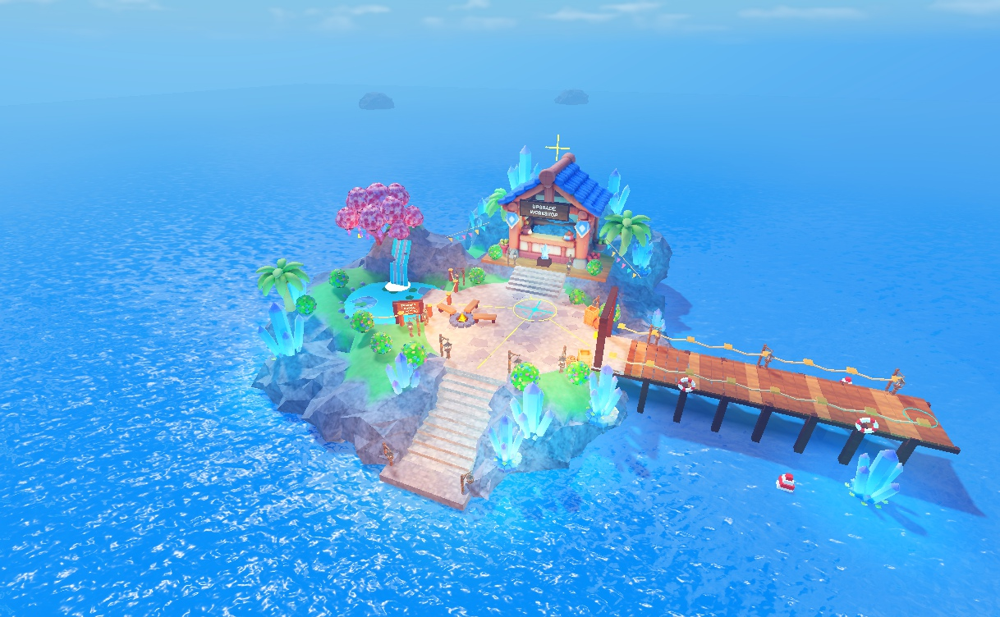
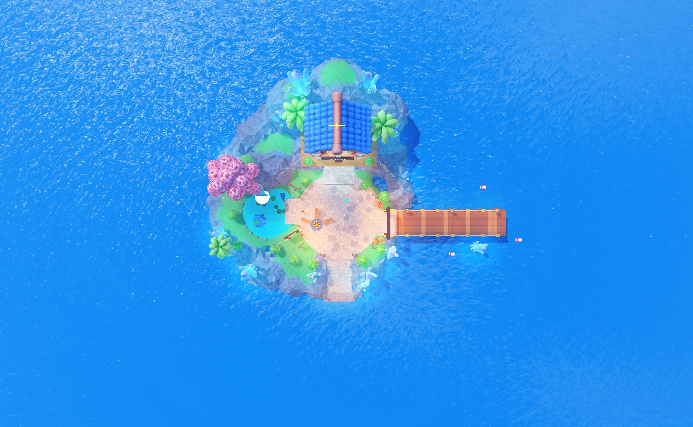
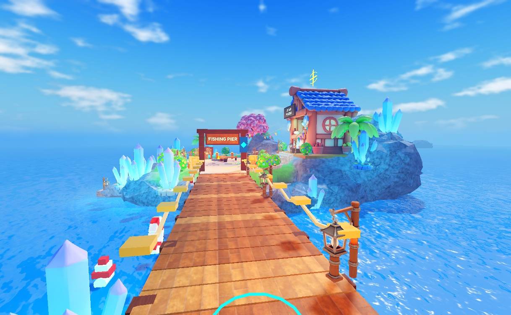
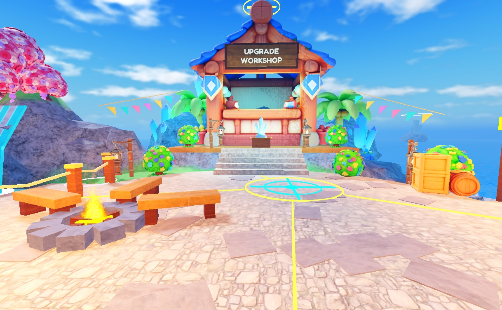
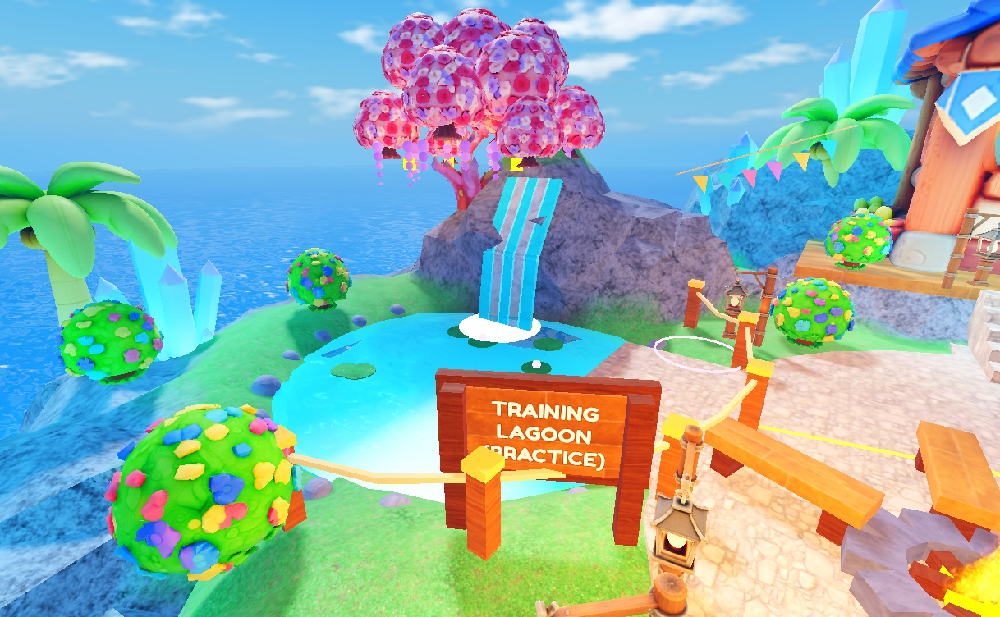

# Legendary Catch — Mapa atual (2026-11-17)

Ilha-hub compacta cercada por oceano, montada a partir da arte aprovada (`art/reference/island-approved.png`).
Gerada por `tools/IslandGenerator.luau` (terreno + peças + meshes de IA salvos no place).

## Layout

| Área | Onde | O que tem |
|---|---|---|
| **Praça central** | meio | Piso de pedra, símbolo de cristal brilhante, filetes dourados até cada área, fogueira com 3 bancos, spawn |
| **Oficina de melhorias** | fundo, num terraço elevado | Cabana de telhado azul (mesh IA), placa "UPGRADE WORKSHOP", pedestal com cristal, emblema dourado no telhado, bandeirolas |
| **Lagoa de treino** | esquerda | Água turquesa, cachoeira descendo do penhasco, vitórias-régias, peixinhos, cerca com corda, placa "TRAINING LAGOON (PRACTICE)" |
| **Árvore rosa** | esquerda, atrás da lagoa | Tronco torcido + copa de flores rosa/lilás, cachos pendurados e lanternas |
| **Escadaria** | frente | Degraus de pedra descendo até a água, rochas e cristais nas laterais |
| **Píer de pesca** | direita | Píer de madeira (~66 studs), arco "FISHING PIER", corda, lanternas, boias salva-vidas, caixotes; **zona de pesca** no fim |
| **Entorno** | volta toda | Costa de rocha, palmeiras, cristais azuis grandes, arbustos floridos, boias no mar |
| **Horizonte** | longe | Mar com degradê turquesa→azul-marinho, neblina, ilhotas e cidadela com anel de luz (só cenário) |

## Pontos de vista

**Chegando pelo píer**

**O que o jogador vê ao nascer**

**Lagoa de treino**

## Números

- Ilha ~120 × 100 studs; praça a 10 studs acima do mar, terraço da oficina a ~14.
- Caminhada do spawn: píer ~5 s, oficina ~2 s, lagoa ~2,5 s, pé da escada ~3 s.
- Oceano de 2048 × 2048 studs; zoom da câmera limitado a 90 pra borda não aparecer.
- ~860 instâncias na ilha, 35 luzes.

## O que funciona hoje

- Pesca de teste no fim do píer (lance, fisgada, 3 minigames, revelação por raridade).
- Oficina e lagoa são só cenário (sem interação ainda).

## Não testado

Celular (FPS com bloom/neblina/35 luzes), 2+ jogadores, jogo publicado.
