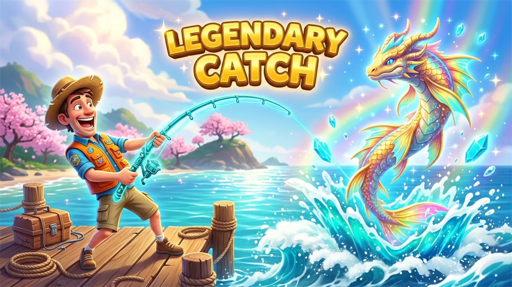

# Legendary Catch



Jogo de pesca fantástica e coleção de criaturas para **Roblox** (mobile-first e PC): explore uma ilha mágica e áreas oceânicas progressivas, domine 3 minigames de habilidade, revele criaturas em animações cinematográficas por raridade e complete o bestiário.

Visão original do projeto: [CONTEXTO_MESTRE.md](CONTEXTO_MESTRE.md) · Índice de documentos: [docs/INDICE.md](docs/INDICE.md).

---

## Features Principais

- **106 criaturas em 6 raridades + variante Cintilante (`Shiny`):** `Common`, `Uncommon`, `Rare`, `Epic`, `Legendary` e `Mystic` (incluindo `6` criaturas sazonais natalinas `C101`–`C106`), cada uma com modelo 3D animado proceduralmente (`CreatureMotion`), peso variável, recorde pessoal e lore em PT-BR/EN-US.
- **3 minigames de habilidade:** `Reel`, `Precision` e `Rhythm` (`Control`/`Input`), escalando em dificuldade por tier e com revelações cinematográficas por raridade e estilo (`Reveal` + `RevealStyles`).
- **3 zonas de pesca e progressão de nível (`PlayerLevel`):**
  - **Lagoa Inicial (`lagoon`)** — nível 1+ (píer da ilha).
  - **Recife de Coral (`coral`)** — nível 5+, bônus para `Rare` (`1.4×`) e `Epic` (`1.3×`).
  - **Abismo Estelar (`abyss`)** — nível 15+, bônus para `Epic` (`1.5×`), `Legendary` (`1.6×`) e `Mystic` (`1.3×`).
- **Oficina de varas (8 tiers) e Treino na Lagoa:** compre e equipe varas (`starter` até `mystic`) com bônus de **Controle** e **Sorte**, e treine `Control` / `Instinct` na lagoa semi-idle com bônus de anéis e combo.
- **Eventos do Oceano e Sazonalidade:** `6` eventos globais em rotação (`starTide`, `thunderStorm`, `goldenHour`, `shimmerShoal`, `fogBank`, `aurora`) com clima/iluminação dinâmicos e criaturas exclusivas, além da janela sazonal de Natal (`Seasons.luau`).
- **Retenção e social:**
  - **Maré Nova (Prestígio):** reinicia moedas/varas/treino em troca de multiplicadores permanentes de moeda e sorte.
  - **Sequência Diária (7 dias):** recompensas crescentes + escudo semanal (`streak shield`) + baú especial no Dia 7.
  - **Conquistas, Desafios Diários, Marcos da Coleção e Códigos promocionais.**
  - **Placar global + Inspeção de Álbum:** rankings (`Catches`, `Species`, `Level`) e visualização pública do álbum de jogadores no mesmo servidor.
  - **Troféu da Praça, Áudio completo (`14` sons) e Acessibilidade:** glifos de raridade além da cor, fontes `>= 14 px`, opção `ReduceEffects` e Game Pass de **Auto-pesca** (execução 100% autoritativa no servidor).

---

## Como Rodar Localmente

### Pré-requisitos

Instale as ferramentas gerenciadas pelo [Rokit](https://github.com/rojo-rbx/rokit) (`rokit.toml` define `rojo@7.7.0`, `wally@0.3.2`, `StyLua@2.5.2`, `selene@0.31.0`):

```bash
rokit install
```

Se precisar restaurar pacotes do `wally.toml`:

```bash
wally install
```

### Sincronizando com o Roblox Studio (Rojo)

Inicie o servidor do Rojo na porta `34873` (conforme o fluxo do projeto):

```bash
rojo serve --port 34873
```

No Roblox Studio, abra o place **Legendary Catch** (`112666482424701`) e conecte o plugin do Rojo em `localhost:34873`.

Mapeamento definido em [`default.project.json`](default.project.json):

| Pasta local | Destino no `DataModel` |
|---|---|
| `src/shared` | `ReplicatedStorage.Shared` |
| `src/server` | `ServerScriptService.Server` |
| `ServerPackages` | `ServerScriptService.ServerPackages` |
| `src/client` | `StarterPlayer.StarterPlayerScripts.Client` |
| `tools` | `ServerStorage.DevTools` |

> **Nota:** o mapa da ilha, as `106` criaturas em `ReplicatedStorage.Creatures`, os `14` áudios em `ReplicatedStorage.Audio` e os modelos de varas ficam salvos diretamente no arquivo de place na nuvem (não em `src/`).

---

## Estrutura de Pastas

```text
.
├── art/                    # Artes de marketing (art/marketing/), prints de referência e guias de criaturas
├── docs/                   # Documentação ativa, checklists, economia, performance e histórico
├── src/
│   ├── client/
│   │   ├── Data/           # Cache reativo do snapshot do perfil no cliente
│   │   └── Features/       # 31 features de cliente (Hud, Fishing, Collection, Shop, Training, Events, etc.)
│   ├── server/
│   │   ├── Remotes.luau    # Criação e rate-limit de RemoteEvents
│   │   └── Features/       # 16 features autoritativas (Fishing, PlayerData, Journey, Progress, Prestige, etc.)
│   └── shared/
│       ├── Config/         # Catálogos e balanceamento (Creatures, Rods, Events, Zones, Seasons, Products, etc.)
│       ├── Net.luau        # Contrato e tipos compartilhados de remotes
│       ├── Strings.luau    # Textos do jogo (PT-BR / EN-US)
│       ├── StringsUi.luau  # Textos de interface (PT-BR / EN-US)
│       ├── Types.luau      # Tipos de perfil e snapshot
│       └── UiTheme.luau    # Paleta, tipografia e utilitários visuais (incl. glifos de raridade)
├── tools/                  # Scripts auxiliares (economy-sim.js, IslandGenerator.luau, RodModelsBuilder.luau)
├── default.project.json    # Configuração Rojo
├── rokit.toml              # Versões pinadas de Rojo, Wally, StyLua e Selene
├── selene.toml / stylua.toml / .luaurc
└── wally.toml              # Dependências (ProfileStore no servidor)
```

---

## Convenções de Código

- **Feature Loader automático:** [init.client.luau](src/client/init.client.luau) e [init.server.luau](src/server/init.server.luau) escaneiam `Features/*`, executam módulos que expõem `start()` ordenados por `order` (padrão `100`). Novas features não precisam editar os entrypoints.
- **Configs centralizados:** toda tabela de conteúdo e balanceamento vive em `src/shared/Config/` (lida tanto pelo servidor quanto pela UI).
- **Regra de ouro (Autoridade do Servidor):** o cliente **nunca** decide moedas, captura, raridade, peso, compras ou desbloqueios; apenas envia intenção e renderiza o resultado devolvido pelo servidor.
- **Tipagem e qualidade:** `--!strict` obrigatório nos módulos em `src/`. Rode antes de commitar:

```bash
stylua src
selene src
rojo sourcemap -o sourcemap.json
luau-lsp analyze --base-luaurc=.luaurc --sourcemap=sourcemap.json src
```

Para simular a economia em linha de comando:

```bash
node tools/economy-sim.js
```

---

## Como Adicionar Conteúdo Novo

1. **Criatura:** siga [docs/CRIATURAS-NOVAS.md](docs/CRIATURAS-NOVAS.md) para gerar/orientar (`+Z`) o modelo em `ReplicatedStorage.Creatures` e salvar no place (`save_place`), depois cadastre atributos em [`src/shared/Config/Creatures.luau`](src/shared/Config/Creatures.luau) e nome/lore PT/EN em [`src/shared/Strings.luau`](src/shared/Strings.luau).
2. **Vara:** adicione uma entrada em [`src/shared/Config/Rods.luau`](src/shared/Config/Rods.luau), traduza o nome em `Strings.luau` e inclua o modelo correspondente se necessário ([`tools/RodModelsBuilder.luau`](tools/RodModelsBuilder.luau)).
3. **Evento do Oceano / Zona:** cadastre em [`src/shared/Config/Events.luau`](src/shared/Config/Events.luau) ou [`src/shared/Config/Zones.luau`](src/shared/Config/Zones.luau) com nomes PT/EN em `Strings.luau` (e adicione `FishingZone` com `ZoneId` no mapa para zonas).
4. **Conquista:** adicione a regra em [`src/shared/Config/Achievements.luau`](src/shared/Config/Achievements.luau) (usando métricas suportadas pelo servidor) e nome/descrição em [`src/shared/StringsUi.luau`](src/shared/StringsUi.luau).
5. **Código promocional:** adicione `{ code = "...", coins = ... }` em [`src/shared/Config/Codes.luau`](src/shared/Config/Codes.luau).

---

## Documentação Principal

- [docs/INDICE.md](docs/INDICE.md) — índice completo de todos os documentos (ativos e históricos).
- [MAPA.md](MAPA.md) — inventário e referências visuais da ilha.
- [docs/AUDIO.md](docs/AUDIO.md) — catálogo dos 14 sons em `ReplicatedStorage.Audio`.
- [docs/ECONOMIA-2026-11-18.md](docs/ECONOMIA-2026-11-18.md) — curva de moedas, varas, zonas e místicas.
- [docs/PERFORMANCE.md](docs/PERFORMANCE.md) — auditoria mobile e otimizações de cena/renderização.
- [docs/BUGBASH.md](docs/BUGBASH.md) — cobertura de testes E2E e pendências para teste em aparelho real.
- [docs/PAGINA-DO-JOGO.md](docs/PAGINA-DO-JOGO.md) — textos prontos e artes (`art/marketing/`) para o Creator Hub.
- [docs/ATUALIZACOES.md](docs/ATUALIZACOES.md) — plano pós-lançamento de 8 semanas.
- [docs/LIMPEZA.md](docs/LIMPEZA.md) — auditoria de código morto, `TODO`s e segurança.

---

## Antes de Publicar

Siga o checklist completo em **[docs/PUBLICAR.md](docs/PUBLICAR.md)** antes de clicar em **Publish to Roblox**:

- Habilitar **Studio Access to API Services** e testar persistência real (`ProfileStore` + `OrderedDataStore`).
- Criar os **Developer Products** e **Game Passes** no Creator Hub e substituir os `id = 0` em `src/shared/Config/Products.luau`.
- Subir ícone, thumbnails e textos de `art/marketing/` + `docs/PAGINA-DO-JOGO.md`.
- Conferir que nenhum atributo `Dev*` de QA ficou salvo no Place.
