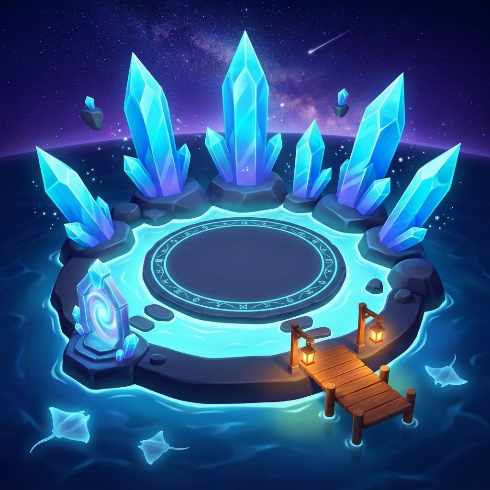
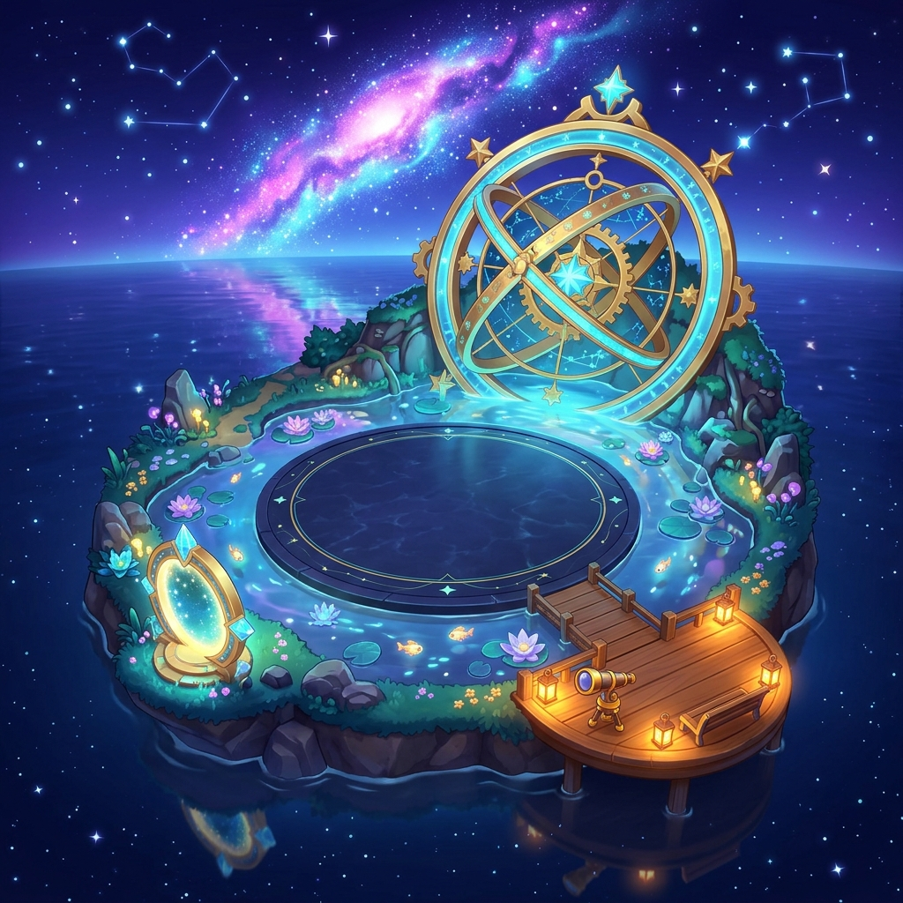
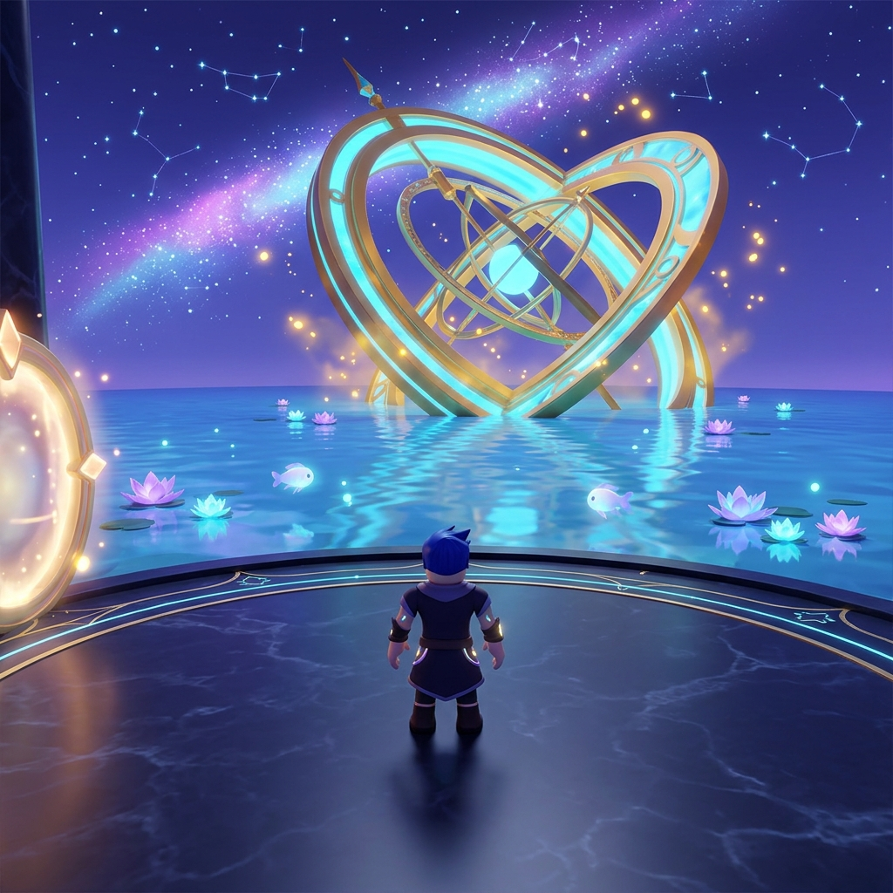
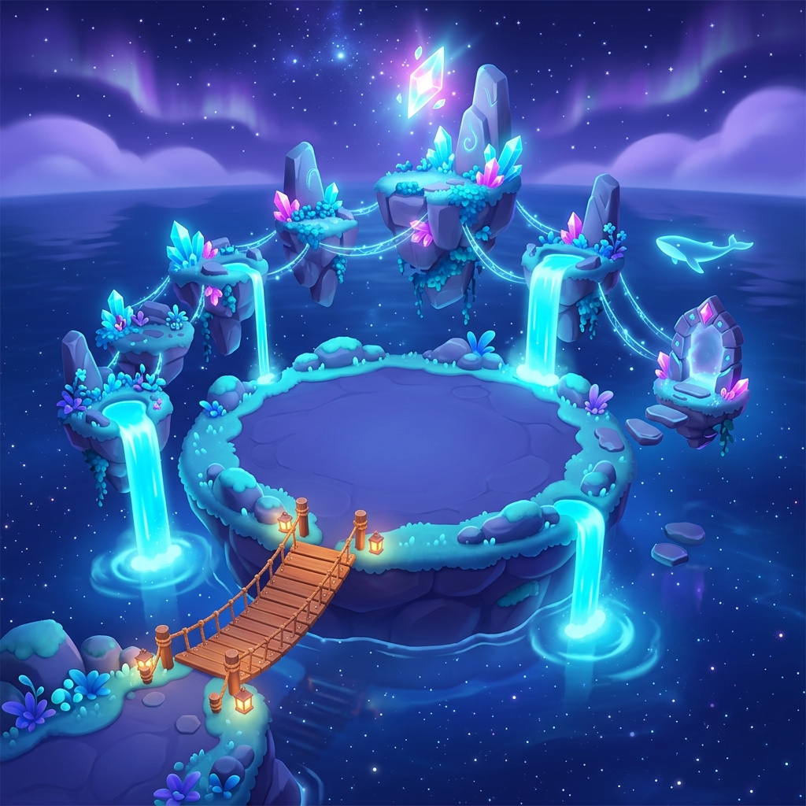
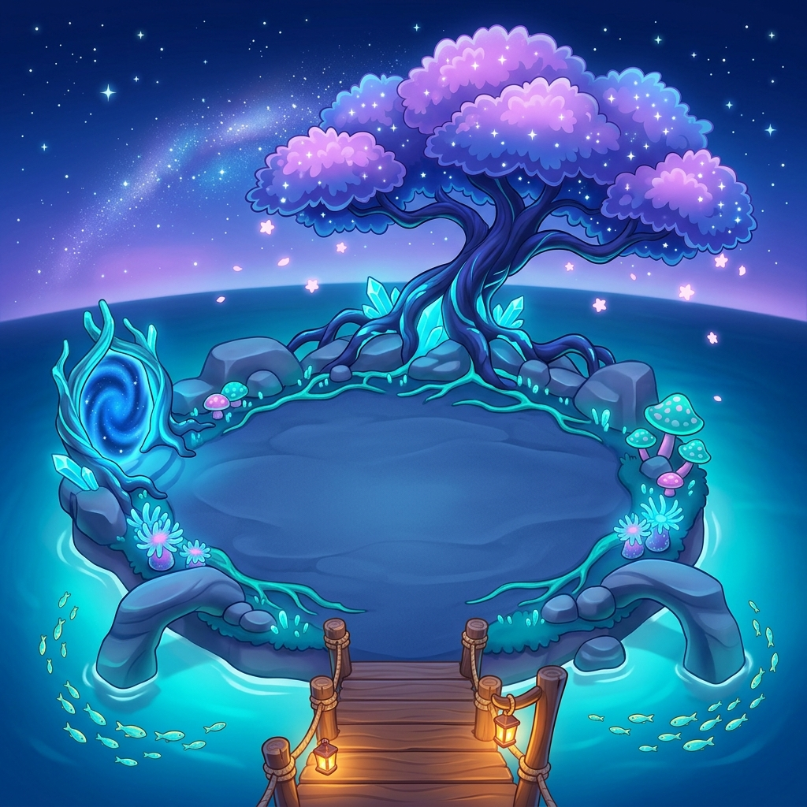

# Conceitos — Ilha Abismo Estelar (`TrainingIsland_Abyss`, x12)

Quatro propostas distintas para o redesenho da **Ilha Abismo Estelar** (multiplicador **x12**, desbloqueio em 100M de Poder de Pesca, posição `(-520, 12, 420)`, `TrainingIsland = 3`).  
Todas preservam um platô central plano com **raio livre ≥ 35 studs** em volta do `TrainingSpot` (acomodando o kit de 10 níveis do campo de treino, que chega a `50,5 × 37,2 × 57,2` studs no Nv10), respeitam o orçamento mobile (**≤ 450 peças visíveis, ≤ 6 luzes, ≤ 8 emissores, 0 scripts nas peças, sem z-fighting**) e mantêm a noite encantadora e legível.

> **Nota sobre imagens opcionais (`*_jogador.png`):** todas as 4 vistas aéreas 3/4 obrigatórias (`1024 × 1024 px`, sem texto) foram geradas e conferidas, mais a vista opcional do ponto de vista do jogador para a **V2** (`ilha-abismo_v2_jogador.png`). As vistas opcionais de jogador da V1, V3 e V4 não foram geradas porque o gerador de imagem atingiu o limite temporário de cota (`429 RESOURCE_EXHAUSTED`).

---

## V1 — Coroa da Estrela Caída

**Medidas aproximadas:** ilha total `~112 × 64 × 112` studs · arena central plana `r = 36` studs (`Y = 12`) · anel de lagoa rasa largura `10` studs · agulha central `~48` studs de altura.

A versão mais fiel à lenda da cratera: a estrela caída abriu uma bacia circular no mar noturno e fez brotar **seis grandes agulhas de cristal azul-elétrico inclinadas para fora como as pontas de uma coroa**, acompanhadas por dois rochedos flutuantes com cristais menores — uma silhueta de "coroa brilhante" impossível de confundir à distância.
A paleta combina pedra azul-noite fosca, cristais azul-elétrico/ciano neon, reflexos lilás na névoa e o contraste acolhedor de madeira quente com duas lanternas âmbar.
O **`TrainingSpot`** fica no centro do disco de pedra escura contornado por um anel rúnico ciano rente ao chão (`r = 36` studs livres); o **spawn de chegada** fica no píer de madeira a sudeste (`+Z/+X`, ~44 studs do centro) mirando direto a maior agulha ao fundo; e o **portal de volta** é um arco de cristal com vórtice ciano-lilás a sudoeste (`+Z/-X`, ~45 studs), ligado por pedras-degrau sobre a lagoa rasa.
A vida vem da lagoa bioluminescente em ondas lentas, das arraias de luz translúcidas deslizando fora do anel de rochas, do pó estelar subindo suave perto dos cristais e de estrelas cadentes ocasionais no céu.
Para quem treina parado, a evolução é dramática: nos níveis iniciais o jogador vê a arena aberta refletindo o céu dentro da coroa, e conforme o campo de treino cresce até o Nv10 (`37` studs), o santuário dourado parece "coroado" pelas agulhas de cristal ao fundo sem tampar a câmera.
Na construção leve (~240 peças, 4 luzes, 5 emissores): **Terrain** (`Water` + `Basalt`/`Rock`) faz o fundo da lagoa e o anel rochoso base; **MeshParts/Partes grandes** formam o platô, o píer, o portal e apenas 2–3 modelos de cristal reaproveitados em escalas diferentes (`CastShadow = false` nos detalhes); e **ParticleEmitters** + `Beam` suave fazem o pó estelar e o brilho das arraias.

---

## V2 — Observatório do Espelho Astral

**Medidas aproximadas:** ilha total `~120 × 70 × 116` studs · disco de mármore noturno `r = 35` studs (`Y = 12`) · lagoa espelhada largura `12` studs · astrolábio monumental `~52` studs de altura.

Aqui a estrela caída inspirou antigos pescadores a erguer um observatório mágico sobre o mar: o **marco principal** é um **astrolábio celestial monumental em dourado e ciano neon**, semi-submerso na borda norte da lagoa, cuja silhueta de anéis entrelaçados e engrenagens estelares se destaca instantaneamente no horizonte.
A paleta equilibra índigo noturno profundo e mármore escuro com dourado quente, ciano elétrico, lótus lilás-magenta e lanternas âmbar, trazendo sensação de prestígio e magia sem ficar sombria.
O **`TrainingSpot`** ocupa o centro do disco plano de mármore noturno com linhas finas douradas e ciano apenas na borda (`r = 35` studs totalmente livres); o **spawn de chegada** fica num deck de madeira em meia-lua a sudeste (`+Z/+X`, ~46 studs do centro) equipado com banco, lanternas âmbar e uma luneta estilizada, ligado por ponte baixa; e o **portal de volta** é um anel vertical dourado-cristal a sudoeste (`+Z/-X`, ~46 studs) bem visível já na chegada.
O cenário ganha vida com a lagoa rasa refletindo a faixa galáctica magenta-ciano, peixes-lanterna dourados circulando sob a água perto dos lótus luminosos, vaga-lumes dourados flutuando em torno do astrolábio e um pulso lento no núcleo azul central.
Da vista do jogador em pé treinando, o horizonte fica limpo sobre o espelho d'água, e conforme o campo de treino sobe de nível (especialmente a partir da Arena Rúnica Nv6 e do Santuário Dourado Nv10), os detalhes dourados do campo se fundem visualmente ao astrolábio ao fundo como se pertencessem à mesma construção.
Na construção leve (~290 peças, 5 luzes, 5 emissores): **Terrain** (`Water`, `Slate`/`Rock` e vegetação rasteira na margem) desenha o atol-espelho; **1 Hero Mesh** (ou conjunto modular limpo de anéis/arcos) constrói o astrolábio e outro o portal; o deck, ponte e disco central usam poucas peças largas sem coplanaridade; e **ParticleEmitters** geram os vaga-lumes e o brilho suave dos lótus.

---

## V3 — Jardim das Pedras Flutuantes

**Medidas aproximadas:** ilha total `~126 × 82 × 120` studs · platô principal `r = 35` studs (`Y = 12`) · 5 ilhotas flutuantes entre `Y = 22` e `Y = 58` · fragmento estelar no pico `Y = 74`.

A queda da estrela alterou a gravidade do local e suspendeu pedaços da cratera no ar: o **marco principal** é um **arco ascendente de 5 monólitos flutuantes coroados por um fragmento de estrela brilhante em ciano e magenta**, criando uma silhueta vertical em espiral ligada por cachoeiras luminosas que caem direto no mar escuro.
A paleta aposta em rocha índigo-violeta, musgo azulado, cachoeiras ciano neon, cristais ciano e rosa-magenta, auroras lilás no céu e o toque aconchegante de madeira quente com lanternas âmbar na ponte.
O **`TrainingSpot`** fica no centro do platô circular amplo e plano de pedra índigo com borda baixa de musgo azul (`r = 35` studs livres); o **spawn de chegada** nasce numa ilhota satélite baixa a sudoeste (`+Z/-X`, ~50 studs) ligada por uma ponte pênsil de madeira com lanternas âmbar; e o **portal de volta** flutua numa pequena plataforma de pedra e cristais a leste (`+X`, ~46 studs), acessível por 2 degraus largos e planos de pedra levitando.
O movimento constante vem das 3 cachoeiras bioluminescentes caindo com anéis de névoa na água, das linhas tênues de energia conectando as pedras flutuantes, das faíscas subindo devagar em torno do cristal estelar no topo e da silhueta serena de uma baleia de luz deslizando ao longe.
Para quem treina por horas, a verticalidade faz o campo de treino parecer "ascender" junto com a ilha: do Nv1 ao Nv8 o jogador contempla as cachoeiras e o cristal no alto, e nos Nv9–Nv10 (Plataforma Flutuante e Santuário) o próprio campo acompanha a estética antigravidade do arquipélago.
Na construção leve (~310 peças, 5 luzes, 7 emissores): **Terrain** (`Water` + rochas da base submersa) ancora o oceano e o bloco principal; **5 blocos/meshes de rocha flutuante** + grupos modulares de cristais e a ponte de madeira formam a estrutura; **`Beam` com textura animada** desenha as cachoeiras e fios de luz com custo mínimo; e **ParticleEmitters** fazem a névoa na base das quedas e as faíscas do fragmento estelar.

---

## V4 — Santuário da Árvore-Galáxia

**Medidas aproximadas:** ilha total `~114 × 68 × 114` studs · praça circular plana `r = 35` studs (`Y = 12`) · copa da Árvore-Galáxia `~54` studs de altura por `~56` studs de envergadura.

O lado mais acolhedor e mágico do Abismo Estelar: a estrela caída nutriu o oceano e fez brotar uma **Árvore-Galáxia gigante com raízes cristalinas ciano e copa fofa em lilás, magenta e azul-noite salpicada de estrelas** — um eco noturno e épico da árvore rosa do hub, criando uma silhueta orgânica icônica de longe.
A paleta une azul-marinho e turquesa bioluminescente na enseada com copa lilás-magenta brilhante, cogumelos e anêmonas verde-água/rosa e um cais frontal de madeira rústica com lanternas âmbar bem quentes.
O **`TrainingSpot`** fica no centro da clareira circular de pedra-areia azul-escura cercada por pedras lisas baixas e raízes luminosas embutidas na borda (`r = 35` studs totalmente desimpedidos); o **spawn de chegada** fica no píer de pescador em madeira e cordas ao sul (`+Z`, ~43 studs do centro), emoldurando a árvore-galáxia inteira à frente; e o **portal de volta** é um arco orgânico de raízes cristalinas entrelaçadas a oeste (`-X`, ~44 studs), fácil de achar sem brigar com a árvore.
A ilha respira com pétalas-estrela caindo devagar ao redor das bordas da copa (fora da linha da câmera central), cardumes de peixes-lanterna ciano-dourados circulando os arcos de pedra na água turquesa e brilho pulsante suave nas anêmonas e raízes.
Para quem passa horas treinando no centro, é a versão mais confortável aos olhos: cores macias, luz quente perto dos pés e a copa estrelada abraçando o fundo enquanto o campo de treino evolui de uma simples clareira (Nv1) até um santuário místico protegido sob os galhos da árvore (Nv10).
Na construção leve (~270 peças, 5 luzes, 6 emissores): **Terrain** (`Water`, `Sand`/`Rock`) molda a enseada rasa e os arcos costeiros; **1 Hero Mesh** (ou tronco modular + nuvens de copa arredondadas) faz a Árvore-Galáxia e outro o arco de raízes do portal; cogumelos, anêmonas e píer usam poucos props repetidos com `CastShadow = false`; e **ParticleEmitters** soltam as pétalas-estrela suaves e o brilho da água.

---

## Comparativo rápido para escolha

| Versão | Marco principal (silhueta) | Clima predominante | Destaque visual | Orçamento estimado |
|---|---|---|---|---|
| **V1 — Coroa da Estrela Caída** | 6 agulhas gigantes de cristal em coroa | Épico / místico clássico | Leitura imediata da cratera e da estrela caída | ~240 peças · 4 luzes · 5 emissores |
| **V2 — Observatório do Espelho Astral** | Astrolábio monumental dourado e ciano | Majestoso / contemplativo | Reflexo de espelho + contraste ouro/ciano | ~290 peças · 5 luzes · 5 emissores |
| **V3 — Jardim das Pedras Flutuantes** | Monólitos em espiral + cachoeiras neon + estrela | Fantástico / vertical | Cachoeiras luminosas e sensação antigravidade | ~310 peças · 5 luzes · 7 emissores |
| **V4 — Santuário da Árvore-Galáxia** | Árvore-Galáxia lilás-magenta com raízes ciano | Acolhedor / encantador | Conforto visual para horas + elo com o hub | ~270 peças · 5 luzes · 6 emissores |
