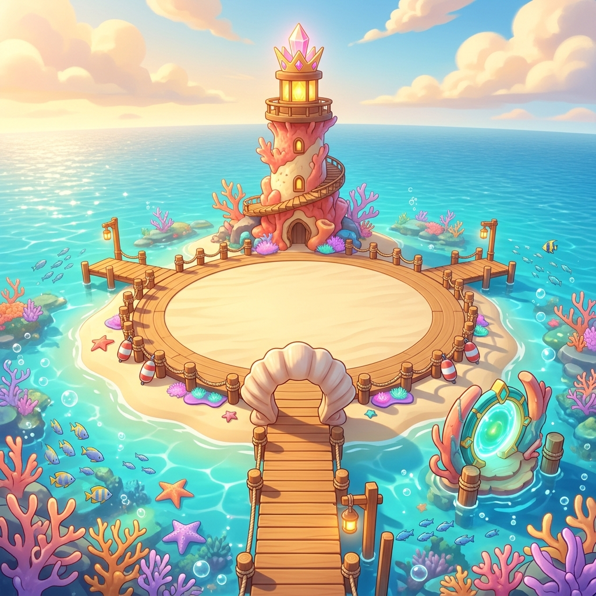
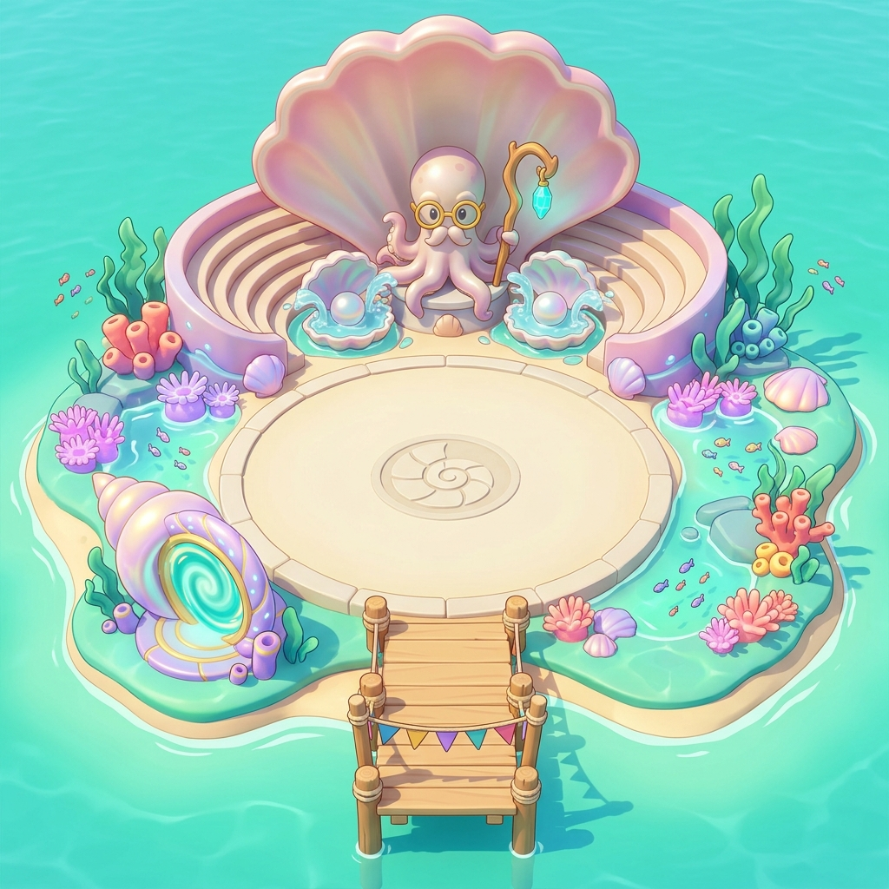
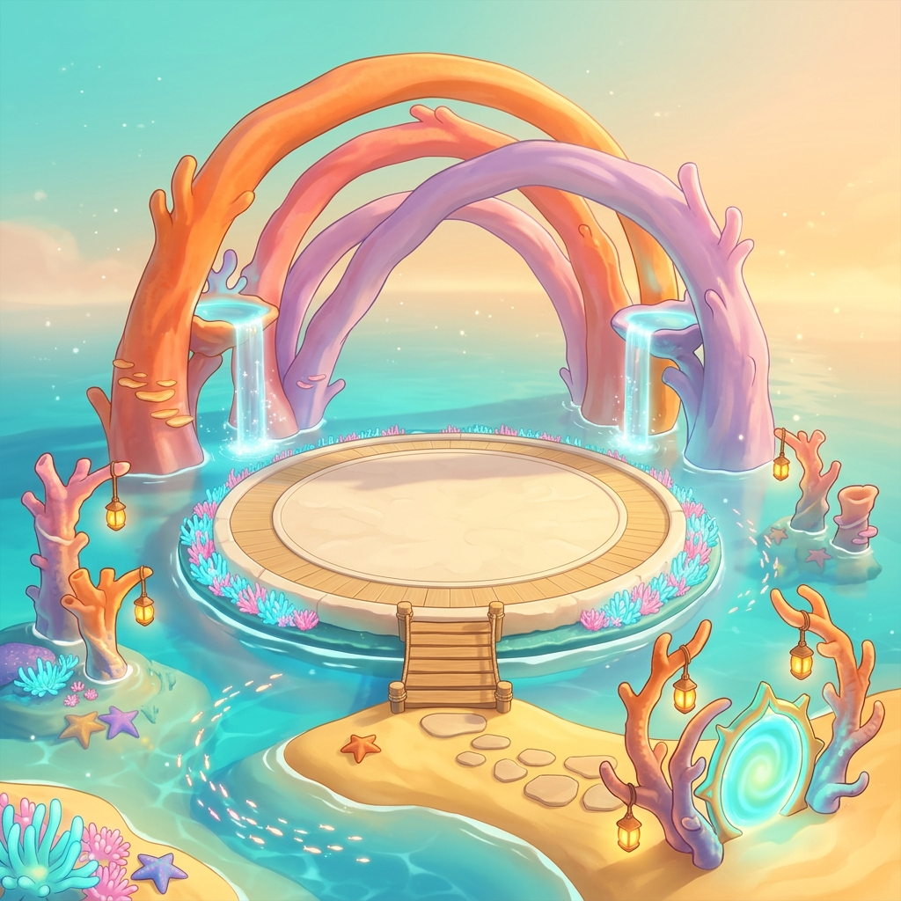
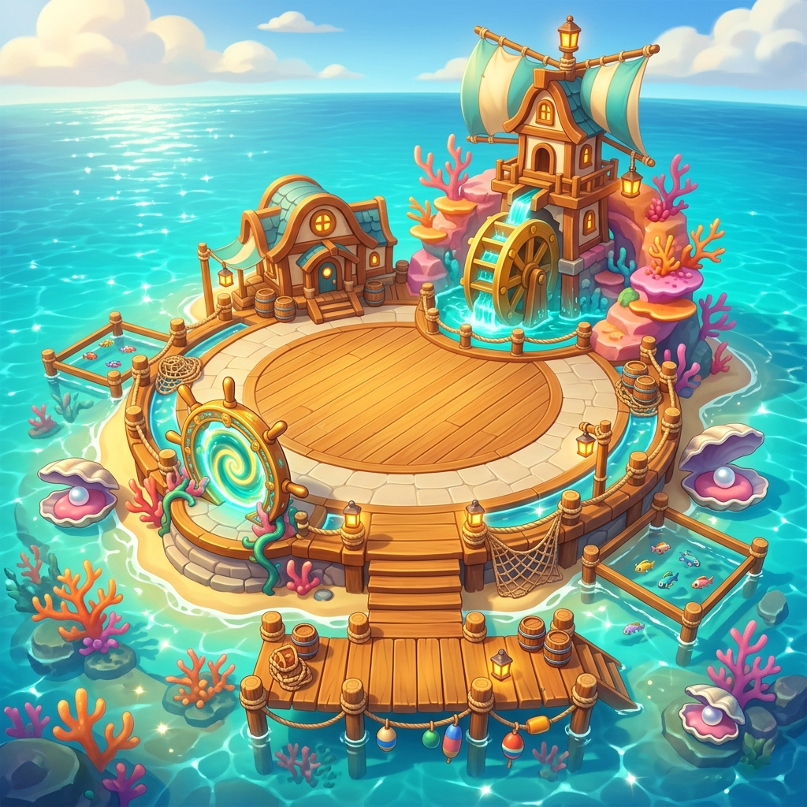

# Ilha do Recife — 4 Conceitos de Arte

Ilha de treino **x3 Poder de Pesca** (`TrainingIsland_Reef`, `(480, 12, 420)` · libera com **100 mil** de Poder).
Todas as 4 versões preservam um **platô central plano e 100% livre de ~34 studs de raio** (`TrainingSpot`, `TrainingIsland = 2`) para receber os 10 níveis do kit de campo de treino sem encostar em nada, respeitam o orçamento mobile (≤ 450 peças visíveis, ≤ 6 luzes, ≤ 8 emissores, 0 scripts) e não tocam no hub.

> Nota: as vistas opcionais `*_jogador.png` ficaram de fora porque a cota do gerador de imagem bateu limite (`429 RESOURCE_EXHAUSTED`) logo após fechar a V3; as 4 imagens aéreas principais (`1024×1024`, sem texto) estão completas abaixo.

---

## V1 — Farol de Coral & Atol dos Aprendizes

- **Conceito:** A leitura clássica e acolhedora da lenda do *Recife dos Aprendizes*: um atol de areia creme rodeado por lagoa turquesa rasa, com um deck circular de madeira quente no centro cercado por postes com cordas, boias náuticas e tapetes de anêmona brilhando na borda.
- **Marco principal:** Um **Farol Vivo de Coral** (~38 studs de altura) ao fundo (`-Z`), esculpido em coral-rosa e calcário creme, abraçado por uma escada espiral de madeira e coroado por uma lanterna âmbar-dourada e um cristal rosa-dourado reconhecível de longe pela silhueta vertical.
- **Cores e clima:** Tarde dourada quente de sol baixo — água turquesa translúcida, areia creme, madeira mel, corais rosa/laranja/lilás, boias vermelho-e-branco, detalhes dourados e lanternas âmbar suaves.
- **Onde fica cada ponto:** **Ponto de treino (`TrainingSpot`)** no centro exato do deck circular plano (`r = 34` studs livres); **Spawn de chegada** na passarela frontal (`+Z`) logo antes do **Arco de Conchas Gigantes** (`Z = +46`); **Portal de volta ao hub** na frente-direita (`+22, +40`), emoldurado por ramos de coral e postes de madeira com anel turquesa.
- **O que se mexe:** Ondulação suave na água rasa, bolhas subindo da lagoa, brilhos leves perto do cristal do farol, lanternas âmbar cintilando sem flash brusco e pequenos cardumes de peixes amarelos/azuis circulando nas bordas (animados no cliente se desejar, zero script no mapa).
- **Visão de quem treina e evolução do campo:** Quem fica parado no centro olha direto para o Farol de Coral e o oceano dourado sem nada bloqueando a câmera; do nível 1 ao 10, o campo cresce em volta dos pés dentro da moldura circular de madeira e, no nível 10, a coroa dourada do santuário "conversa" com o cristal no topo do farol.
- **Como construir (orçamento):** ~260–320 peças, 4 luzes (`PointLight` no farol, arco frontal e portal), 5 emissores (bolhas na água + aura do cristal). **Terrain:** banco de areia raso e fundo do atol (`Sand`) + água rasa (`Water`). **Peças/MeshParts:** 1 Hero Mesh para o Farol de Coral, 1 para o Arco de Conchas, peças simples para o deck circular/passarelas/postes/cordas e 3 modelos clonados de corais/anêmonas/estrelas-do-mar.
- **Medidas aproximadas:** Ilha inteira `~140 × 150` studs · Platô central livre `r = 34` studs (`68` de diâmetro) · Altura do Farol `~38` studs · Caminho Spawn → Ponto `~46` studs.

---

## V2 — Anfiteatro das Conchas & Polvo Mestre

- **Conceito:** Uma "academia do recife" lúdica, carismática e memorável para crianças e colecionadores — uma enseada em forma de concha-anfiteatro perolada onde a estátua bem-humorada de um **Polvo Mestre** vigia os aprendizes com carinho.
- **Marco principal:** **Cúpula de Concha Gigante Perolada** (~36 studs de altura) formando um palco semicircular ao fundo (`-Z`), com a estátua estilizada do **Polvo Mestre** (de óculos redondos dourados, bigodinho e cajado com cristal turquesa) flanqueado por duas fontes de ostra com pérolas gigantes borbulhando.
- **Cores e clima:** Manhã tropical radiante e limpa — mar verde-água/menta bem claro, calcário e areia creme, madrepérola rosa e lilás-lavanda, ouro quente nos óculos/aros, algas verde-esmeralda e corais salmão.
- **Onde fica cada ponto:** **Ponto de treino (`TrainingSpot`)** no centro da arena circular plana de calcário creme com relevo discreto de espiral de concha (`r = 34` studs livres); **Spawn de chegada** no píer de madeira frontal (`+Z = +45`) decorado com bandeirolas coloridas (sem texto); **Portal de volta ao hub** na frente-esquerda (`-24, +34`), encaixado dentro de uma concha-caracol gigante brilhando em ciano e lilás.
- **O que se mexe:** Jatos e borbulhas constantes nas duas fontes de pérolas (emissores leves), brilho suave no cristal do cajado do Polvo Mestre, anel giratório do portal de concha, algas e cardumes minúsculos nadando nas piscinas rasas dos dois lados.
- **Visão de quem treina e evolução do campo:** Ficar horas parado treinando olhando para o Polvo Mestre e as duas fontes borbulhando dá muita personalidade e sensação de "escola dos pescadores"; conforme o campo evolui do nível 1 ao 10, as arquibancadas da concha emolduram a arena crescente como um coliseu amigável sem nunca tampar o céu nem o personagem.
- **Como construir (orçamento):** ~240–300 peças, 4 luzes (cajado do polvo, 2 fontes de pérola, portal), 6 emissores (2 fontes de bolhas, partículas no cajado, brilhos nas anêmonas e portal). **Terrain:** banco de areia raso e recife submerso (`Sand`/`Rock`) + água verde-água (`Water`). **Peças/MeshParts:** 1 Hero Mesh para a estátua do Polvo Mestre, 1 para o Portal Concha-Caracol, 1 modelo clonado de ostra-fonte, e blocos/cilindros leves para a arena, arquibancada e píer.
- **Medidas aproximadas:** Ilha inteira `~135 × 145` studs · Arena central livre `r = 34` studs · Altura da Concha + Polvo Mestre `~36` studs · Caminho Spawn → Ponto `~45` studs.

---

## V3 — Jardim das Marés & Arcos de Coral Vivo

- **Conceito:** Um santuário orgânico e zen esculpido pela própria maré — a ilha parece viva, com arcos monumentais de coral se entrelaçando sobre uma lagoa-espelho calma e um círculo de anêmonas bioluminescentes que abraçam o tatame de treino rente à água.
- **Marco principal:** **Arcos Gigantes Entrelaçados de Coral Vivo** (~42 studs de altura no topo) curvando-se em camadas (tangerina, rosa-coral e lilás) atrás da arena (`-Z`), com duas poças suspensas nos próprios ramos derramando **cascatinhas luminosas de água marinha** direto na lagoa.
- **Cores e clima:** Pôr-do-sol dourado-pêssego (*golden hour* bem vivo) — céu azul-turquesa virando pêssego/dourado no horizonte, água verde-água espelhada, corais laranja-tangerina, coral-rosa e lilás, areia dourada e lanternas âmbar penduradas nos galhos de coral.
- **Onde fica cada ponto:** **Ponto de treino (`TrainingSpot`)** no centro da plataforma circular rasa de pedra coralina e anel de madeira (`r = 34` studs livres, cercada por tapetes de anêmona ciano/rosa fora do raio jogável); **Spawn de chegada** na ilhota de areia frontal (`+Z = +48`) com pedras de passo levando a uma pontezinha baixa de madeira; **Portal de volta ao hub** na frente-direita da ilhota de areia (`+22, +44`), entre dois chifres de coral com lanternas âmbar penduradas.
- **O que se mexe:** As duas cascatas caindo das poças de coral (emissores de névoa + `Beam`/faixas translúcidas em `SmoothPlastic`), partículas lentas de brilho pairando no ar sob os arcos, água rasa refletindo o céu e fileiras de peixinhos luminosos contornando o canal entre a ilhota e a plataforma.
- **Visão de quem treina e evolução do campo:** É a versão mais relaxante e fotogênica para ficar olhando por horas: o arco triplo emoldura o horizonte sem bloquear a vista, e quando o jogador sobe o campo para os níveis 6–10 (runas, fontes, arcos de cristal, plataforma flutuante), os arcos orgânicos criam um contraste mágico de natureza + cristal.
- **Como construir (orçamento):** ~220–280 peças (muito leve porque o foco são poucas formas enormes!), 5 luzes (2 cascatas, 2 conjuntos de lanternas, portal), 7 emissores (2 cascatas + névoa na base, poeira luminosa sob os arcos, bolhas na borda e portal). **Terrain:** bancos de areia e fundo da lagoa rasa (`Sand`) + lâmina de água (`Water`). **Peças/MeshParts:** 2–3 Hero Meshes para os arcos de coral orgânicos (ou segmentos suavizados), lanternas penduradas clonadas e disco plano de pedra/madeira no centro.
- **Medidas aproximadas:** Ilha inteira `~145 × 155` studs · Platô central livre `r = 34` studs · Altura dos Arcos de Coral `~42` studs · Caminho Spawn → Ponto `~48` studs.

---

## V4 — Vila de Pérola & Moinho da Maré

- **Conceito:** Um posto avançado náutico cheio de charme e história — construído pelos pescadores veteranos sobre um recife raso, misturando madeira quente, velas turquesa, redes, viveiros de peixinhos e engenharia mágica movida pela própria maré. Passa sensação forte de lugar vivo, habitado e aventureiro.
- **Marco principal:** **Torre-Moinho de Maré de Madeira e Coral** (~40 studs de altura) encaixada num rochedo coralino ao fundo-direita (`-Z`), com uma **grande roda d'água dourada** puxando água turquesa cintilante para um canal raso que contorna toda a arena, além de duas velas creme-e-turquesa no topo e uma cabaninha de apoio ao lado.
- **Cores e clima:** Tarde costeira ensolarada de aventura — madeira mel e nogueira bem quentes, pedra clara, água azul-caribe vibrante, velas creme/turquesa, coral-laranja e magenta, ouro na roda/timão e lanternas âmbar espalhadas pelo deck.
- **Onde fica cada ponto:** **Ponto de treino (`TrainingSpot`)** no centro da praça circular ampla de madeira e anel de pedra clara (`r = 34` studs livres, cercada por um canalzinho luminoso raso); **Spawn de chegada** no píer de madeira frontal (`+Z = +46`) com barris, cordas, redes e boias coloridas; **Portal de volta ao hub** na frente-esquerda (`-22, +28`), em formato de **Timão Gigante Dourado** envolvido por corais brilhantes.
- **O que se mexe:** A água jorrando da roda d'água do moinho com respingos e espuma cintilante, brilho suave correndo pelo canal de água em volta da arena, peixinhos coloridos nos dois cercados-viveiros laterais, bolhas nas ostras gigantes de pérola e lanternas âmbar quentes.
- **Visão de quem treina e evolução do campo:** Dá a sensação imediata de "agora eu faço parte da guilda dos pescadores de verdade"; o pátio circular central é super limpo e organizado, fazendo os 10 níveis do campo parecerem reformas naturais do próprio posto avançado, sem poluir o olhar.
- **Como construir (orçamento):** ~320–390 peças (dentro do teto de 450, usando `CastShadow = false` em cordas/redes/barris), 6 luzes (topo do moinho, cabana, 2 lanternas do píer, canal, portal), 6 emissores (queda d'água e spray da roda, brilhos no canal, bolhas nas ostras e portal). **Terrain:** recife raso e ilhota de areia (`Sand`/`Rock`) + água azul-caribe (`Water`). **Peças/MeshParts:** 1 Hero Mesh para a Roda d'Água/Moinho, 1 para o Portal Timão Dourado, 1 modelo clonado de ostra com pérola, mais peças limpas para decks, cercados, barris e cabana.
- **Medidas aproximadas:** Ilha inteira `~145 × 150` studs · Praça central livre `r = 34` studs · Altura da Torre-Moinho com velas `~40` studs · Caminho Spawn → Ponto `~46` studs.
