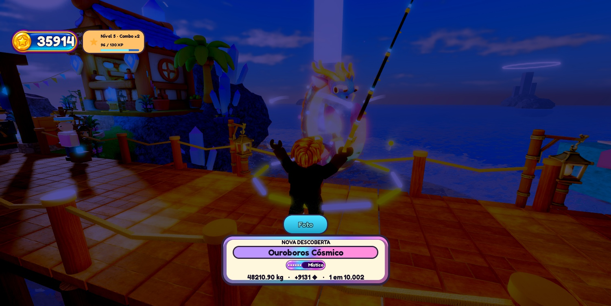
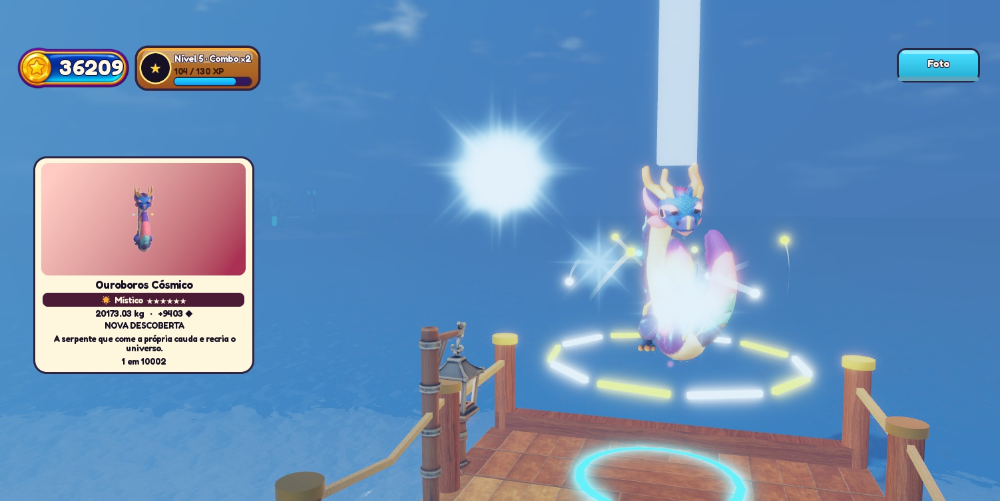

# Revelação de frente

Antes e depois do Ouroboros Cósmico no PC. O print anterior vem de `art/screens/estado-atual`.

| Antes | Depois |
| --- | --- |
|  |  |

## Play no Studio

- PC, área segura de 1502 × 695. Capturas reais com vara equipada e sucesso enviado por `SubmitCatch` após o tempo mínimo: [Incomum C06](after-uncommon-pc.jpg), [Comum C66](after-common-pc.jpg), [Rara C28](after-rare-pc.jpg), [Épica C86 gigante](after-epic-pc.jpg), [Lendária C91](after-legendary-pc.jpg), [Mística C93](after-c93-pc.jpg), [Mística C94](after-c94-pc.jpg) e [Baleia Fantasma C99](after-event-c99-pc.jpg), Lendária do Banco de Névoa.
- iPhone 17 Pro no simulador. [Paisagem](after-mystic-iphone-landscape.jpg) (área segura de 750 × 323), [retrato](after-mystic-iphone-portrait.jpg) (401 × 720) e [retrato com Reduzir efeitos](after-mystic-iphone-portrait-reduced.jpg). No modo reduzido, o modelo do card ficou imóvel e o botão Pular apareceu e foi acionado na recaptura. Os controles de toque e a câmera voltaram ao sair. Em duas capturas consecutivas no PC sem reinicialização de câmera pelo MCP, a câmera voltou para `Custom` depois de ambas.
- Console sem erros Lua do projeto. O Studio ainda registra DataStore desativado e o aviso de tipo do asset 203785492. Testes com um jogador no Studio. Celular físico, dois jogadores, captura e compartilhamento no Modo Foto e experiência publicada ficaram fora do QA.
- Place salvo na nuvem como v59 (`persistedToCloud=true`). Simulador restaurado ao padrão e Studio em Edit.

## Tempo de leitura

Segundos com criatura e card na tela. A entrada e a saída têm tempos próprios. Místico com Reduzir efeitos fica em 4,4 s, antes 2,4 s.

| Raridade | Antes | Agora |
| --- | ---: | ---: |
| Comum | 1,0 s | 2,2 s |
| Incomum | 2,0 s | 3,2 s |
| Rara | 2,4 s | 3,8 s |
| Épica | 2,8 s | 4,5 s |
| Lendária | 3,6 s | 5,5 s |
| Mística | 4,6 s | 6,6 s |

## Auditoria dos modelos

[Inventário dos 106 IDs](models.csv), medido em Edit na versão do place usada no QA. Todos os IDs de Config têm um modelo e `Body` como PrimaryPart. Ângulos do CSV são em relação ao pivô. A auditoria geométrica cobre todos os modelos. A inspeção visual cobre as capturas acima e as amostras de ângulo.

- **Frente da malha diferente do eixo calculado.** C93 tem `Head - Tail` perto de +Z, mas o rosto da malha está em -Z. Ajuste de 180°. C12 tem `Head - Tail` para -Z e alto em Y. Pela malha, o rosto e o corpo ficam legíveis com ajuste de −45°. Veja a [comparação por ângulo](audit-angles.jpg).
- **Eixo diagonal para conferir.** C62, C76, C101 e C102 desviam entre 27° e 30°. C103 desvia cerca de 77°. O cliente usa a direção medida quando há componente horizontal suficiente. C101, C103 e C104 também têm deslocamento de pivô acima de 0,3 stud. O enquadramento usa o centro do bounding box.
- **Sem `Head` separado (29).** C01, C02, C03, C05, C07, C11, C13, C18, C20, C21, C25, C26, C27, C28, C31, C33, C36, C39, C40, C41, C43, C46, C47, C48, C55, C64, C66, C69, C70.
- **Sem `Tail` separado (29).** C03, C04, C05, C09, C11, C14, C15, C18, C23, C25, C27, C28, C30, C37, C38, C40, C42, C45, C47, C49, C55, C64, C66, C69, C70, C73, C85, C104, C105.
- **Eixo quase vertical (21).** C06, C10, C22, C23, C24, C34, C37, C38, C42, C49, C52, C63, C77, C84, C85, C88, C92, C94, C104, C105, C106. Inclui anatomias que naturalmente crescem na vertical. O cliente usa +Z se a geometria não der uma direção horizontal confiável. Com uma extremidade ausente, compara a peça restante com o centro do `Body` quando a distância é suficiente. Antigravity pode validar a frente visual e se a separação faz sentido para cada anatomia.
