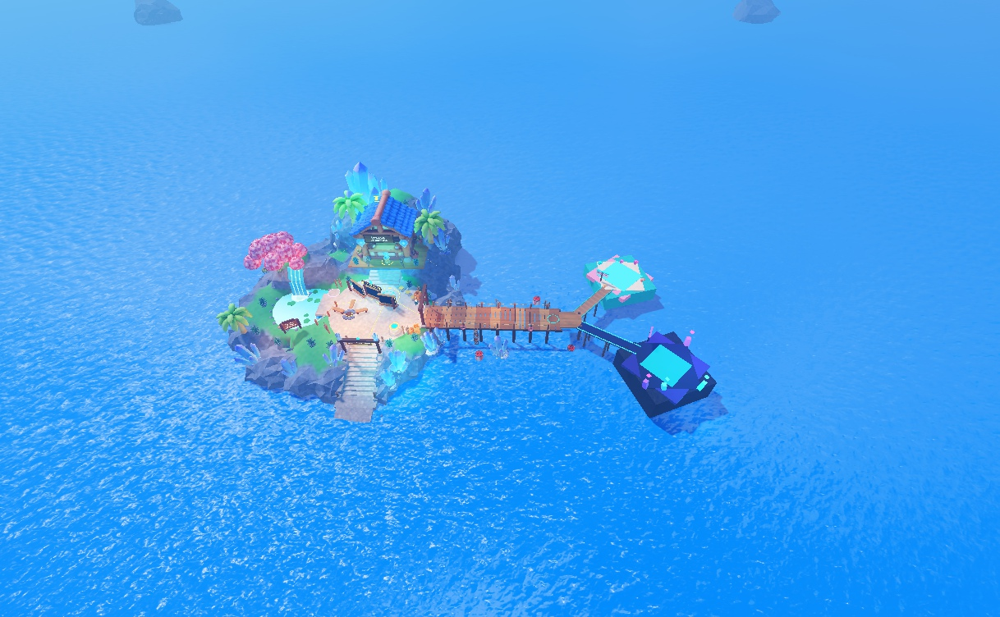
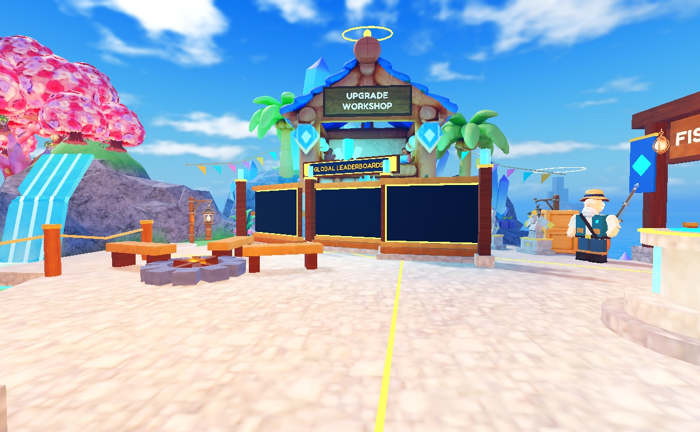
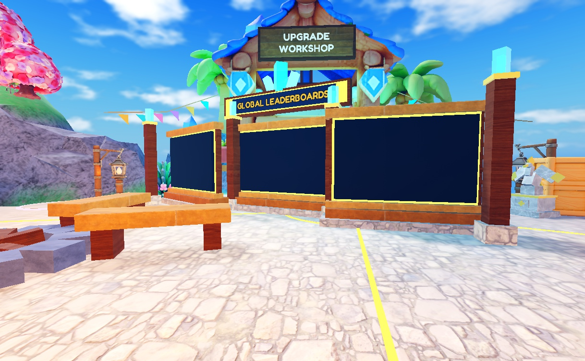
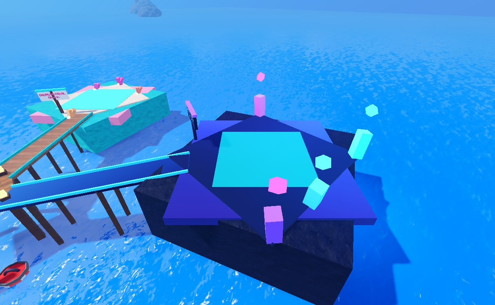
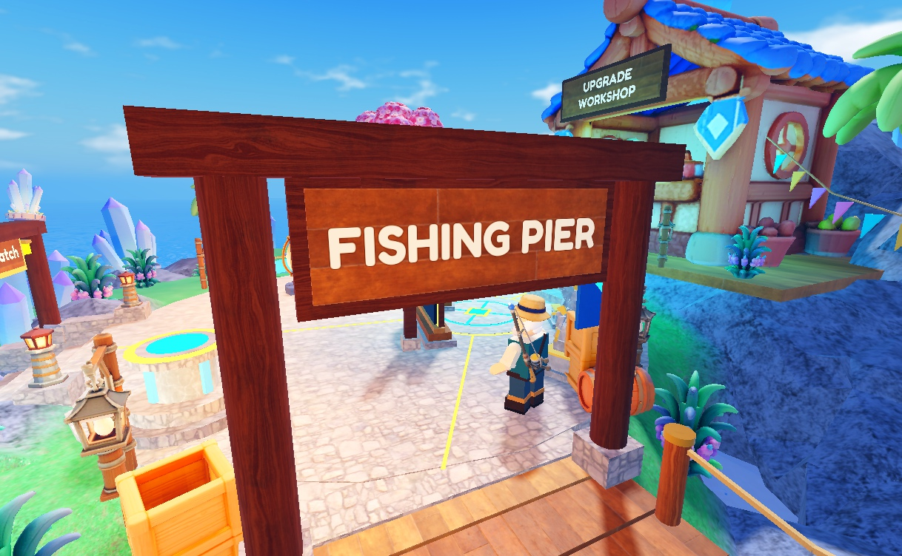
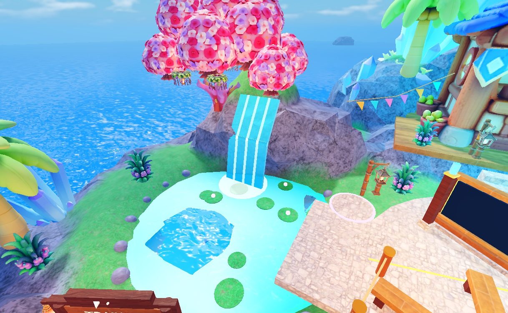

# Ilha: relatório de bugs + prompt para o Gemini

Gerado pelo Claude em 18/11/2026 a pedido do João. Os prints foram tirados no Studio (Edit, viewport nativo). O PDF com os prints está em `docs/ILHA-BUGS-E-PROMPT.pdf`.

## Pedido do João

- Dar uma **polida geral** na ilha para deixá-la praticamente jogável.
- As duas ilhas novas (Recife de Coral e Abismo Estelar) **não fazem sentido** penduradas no pier: devem ser **ilhas acessadas por PORTAIS**.
- O **Placar Global** está num lugar aleatório e parece **flutuar**.
- Fazer uma **varredura completa** por toda a ilha atrás de bugs.

## Resumo dos achados

| Gravidade | Bug |
|---|---|
| ALTA | Zonas de pesca extras (Recife de Coral e Abismo Estelar) estão penduradas no pier e parecem blocos primitivos |
| ALTA | Placar Global (LeaderboardBoard) está num lugar errado e bloqueia a Oficina |
| ALTA | Não há portais, nem transição de zona |
| MÉDIA | Sobras de trabalho dos agentes dentro do Workspace |
| MÉDIA | Textos em inglês nas placas físicas |
| MÉDIA | Detalhes de acabamento na Lagoa de treino |
| A VERIFICAR | Varredura geral (o que ainda não foi medido) |

## Detalhes

### 1. [ALTA] Zonas de pesca extras (Recife de Coral e Abismo Estelar) estão penduradas no pier e parecem blocos primitivos

Dois blocos (Parts/Wedges) no fim do pier, em (118,14,-24) e (128,18,36), ligados por uma ponte reta de 5 studs e uma rampa azul fina, sem estacas na água; a rampa do Abismo atravessa a água como uma tábua. Pilings da "PierJunction" sem chão embaixo. Não têm identidade visual, parecem plataformas de teste. O pedido do João: **elas devem ser acessadas por PORTAIS** que levam a ilhas próprias, não por pontes no pier.

- **Onde:** `Workspace.Island.FishingZonesExtra (CoralReefPlatform, AbyssPlatform, PierJunction, CoralBridge, AbyssBridge)`

### 2. [ALTA] Placar Global (LeaderboardBoard) está num lugar errado e bloqueia a Oficina

Posição (-8,16,-2), tamanho 29x12x5: no centro da praça, colado na frente da Oficina de Varas, escondendo a porta/vitrine; é a primeira coisa que o jogador vê ao nascer (spawn em (-6,10,16)), com 3 painéis escuros que parecem um muro. As vigas "TopBeam_*" ficam a 5,3 studs acima do chão sem apoio visível (efeito de flutuar). O texto do SurfaceGui é pequeno e o título está em inglês ("GLOBAL LEADERBOARDS").

- **Onde:** `Workspace.Island.LeaderboardBoard (tag LeaderboardBoard) + src/client/Features/LeaderboardBoard`

### 3. [ALTA] Não há portais, nem transição de zona

A progressão por zonas (nível 5 e 15) existe no servidor (Config/Zones.luau), mas na ilha o acesso é só andar pela ponte. Falta um portal visível, com nome da zona, nível exigido, estado bloqueado/liberado e um jeito de voltar.

- **Onde:** `src/shared/Config/Zones.luau, src/server/Features/Fishing/init.luau, src/client/Features/Hud/ZoneHud.luau`

### 4. [MÉDIA] Sobras de trabalho dos agentes dentro do Workspace

4 pastas soltas no Workspace: _SegWork1_R1, _SegWork1_B5, _SegWork1_B8, _SegWork1_Fix (3 a 8 partes cada, em Y ~940 a 1040, muito alto no céu). Devem ser apagadas depois de conferir que ninguém usa.

- **Onde:** `Workspace._SegWork1_*`

### 5. [MÉDIA] Textos em inglês nas placas físicas

"FISHING PIER", "UPGRADE WORKSHOP" e "GLOBAL LEADERBOARDS" estão em inglês no modelo; o jogo é PT-BR primeiro (a UI e parte das placas mudam em runtime, mas nem todas).

- **Onde:** `Workspace.Island.FishingPier, UpgradeWorkshop, LeaderboardBoard`

### 6. [MÉDIA] Detalhes de acabamento na Lagoa de treino

Retângulo de água de borda reta (placa de água dentro da lagoa) e cachoeira cortada em ângulo reto; vale suavizar com terreno/água orgânicos como no resto da ilha.

- **Onde:** `Workspace.Island.TrainingLagoon`

### 7. [A VERIFICAR] Varredura geral (o que ainda não foi medido)

Peças flutuando (medir raycast para baixo), peças atravessando umas às outras, buracos no terreno, objetos no mar, paredes invisíveis, ponto de nascimento (Spawn) e caminho do jogador, câmera atravessando pier/casas, colisão em decorações, iluminação/DayNight, densidade de partes para celular, NPCs bloqueando caminhos, placas ilegíveis.

- **Onde:** `toda a Workspace.Island (1.058 descendentes) e Decor`

## Prints

**Print 1.** Visão geral: a ilha principal à esquerda; o pier segue para leste e se divide em duas "ilhas" pequenas (Recife de Coral e Abismo Estelar).



**Print 2.** O Placar fica colado na entrada da Oficina de Varas: as 3 telas escondem a porta e a placa cobre o telhado.



**Print 3.** Do ponto onde o jogador nasce, o Placar é a primeira coisa na frente (parede escura de 3 painéis): parece um muro, não um placar.



**Print 4.** As duas zonas novas: blocos primitivos (cubo azul-escuro girado + cubo turquesa), rampa/ponte reta e fina por cima da água, cristais soltos no ar.



**Print 5.** Arco do pier e Oficina: textos estáticos em inglês ("FISHING PIER", "UPGRADE WORKSHOP"); em Play parte deles é trocada por script, o resto fica em inglês.



**Print 6.** Lagoa de treino (bonita, bom exemplo de acabamento), mas com um retângulo de água de borda reta e a cachoeira cortada em ângulo reto.



## Prompt para mandar ao Gemini (copie tudo dentro do bloco)

````text
Você é o agente de MAPA e 3D do jogo Legendary Catch (Roblox). Antes de tudo leia: AGENTS.md, README.md, docs/COORDENACAO.md (fim) e docs/PROMPT-ANTIGRAVITY.md. Idioma com o João: PT-BR informal e curto; código, nomes e commits em inglês. Studio: use list_roblox_studios (id muda a cada abertura) e o arquivo .studio-lock (10 min sem atualizar = expirado; segure no máximo 15 min por lote). Faça save_place a cada lote e confirme persistedToCloud=true. Commits só dos seus arquivos, SEM push. Anote cada entrega no Mural (docs/COORDENACAO.md).

OBJETIVO: dar uma polida geral na ilha para ela ficar praticamente JOGÁVEL, resolvendo os bugs do relatório docs/ILHA-BUGS-E-PROMPT.md (com prints em art/screens/ilha-bugs/). Siga esta ordem:

1) VARREDURA COMPLETA (antes de mexer): percorra toda a Workspace.Island (1.058 descendentes), Decor, FishingPier, CentralPlaza, TrainingLagoon, UpgradeWorkshop, FrontStairs, Campfire, NPCs e OceanBounds. Para cada problema ache a causa real e registre em docs/ILHA-VARREDURA.md com: onde (caminho + posição), o que, gravidade, print (screen_capture com camera_position/look_at_position; se timeout, tente de novo), como corrigiu. Itens obrigatórios da varredura: (a) peças flutuando (raycast para baixo de cada peça CanCollide com mais de 2 studs; reporte gap > 2.5 e corrija com apoio/estaca/pedra ou reposicione); (b) peças atravessando umas às outras ou o terreno; (c) buracos no terreno e objetos soltos no mar; (d) paredes invisíveis e colisões erradas em decoração; (e) ponto de nascimento (CentralPlaza.PlayerSpawn em (-6,10,16)) e o caminho natural spawn -> Oficina -> pier -> lagoa de treino sem obstáculos (largura mínima de 6 studs); (f) câmera atravessando pier/casas (teste andando); (g) textos de placas em inglês (traduza para PT-BR: "Oficina de Varas", "Pier de Pesca", "Placar Global", "Lagoa de Treino"); (h) NPCs (GuideNPC, NPC_BaitVendor, NPC_ShellGirl) bloqueando caminho ou sobre outro objeto; (i) pastas de sobra no Workspace (_SegWork1_R1, _SegWork1_B5, _SegWork1_B8, _SegWork1_Fix): confirme que ninguém usa por busca e apague; (j) desempenho (conte partes/luzes/emissores e reduza o que for exagerado para celular fraco).

2) PLACAR GLOBAL (Workspace.Island.LeaderboardBoard, tag LeaderboardBoard): reposicione para um lugar que FAÇA SENTIDO e NÃO bloqueie nada: de preferência na lateral da praça perto da fogueira/bancos ou na entrada do pier, de frente para o caminho do jogador, a pelo menos 6 studs da porta da Oficina e de qualquer rota principal, a 10-14 studs do spawn. Ele precisa ser uma estrutura apoiada no chão (postes enterrados, base de pedra), nunca flutuando: confirme com raycast que todas as peças estão apoiadas (gap <= 0.3). Mantenha os nomes LeaderboardScreen_Catches / _Species / _Level e a tag LeaderboardBoard (o cliente em src/client/Features/LeaderboardBoard liga SurfaceGuis nelas): se mudar o tamanho das telas, avise para ajustar a fonte; textos em PT-BR e legíveis a 15 studs. Teste no Play: o placar aparece, os 3 painéis mostram texto e o jogador consegue passar por perto.

3) ZONAS COMO PORTAIS (principal pedido do João): remova as pontes/rampas e as plataformas primitivas penduradas no pier (Workspace.Island.FishingZonesExtra: CoralReefPlatform, AbyssPlatform, PierJunction, CoralBridge, AbyssBridge) e crie, no lugar, um sistema de PORTAIS:
   - Dois portais na ilha principal, em lugar de destaque e fora das rotas principais (sugestão: um arco de cristal perto do fim do pier e outro na lateral da praça; ou os dois lado a lado numa pequena "praça dos portais" com estrutura de pedra, cristais e anéis que giram): "Portal do Recife de Coral" (nível 5) e "Portal do Abismo Estelar" (nível 15). Cada um com visual mágico próprio (anel/arco, partículas leves, luz; cores coral-turquesa e roxo-ciano), placa legível com nome e "Nível N", e estado: liberado (brilha) ou bloqueado (apagado, cadeado, texto "Precisa de nível N"). Leve para celular e desligável por ReduceEffects (atributo do Player no cliente).
   - Cada zona vira uma ILHA PRÓPRIA bem acabada, longe da ilha principal (mais de 250 studs, em direções diferentes, para nunca aparecerem coladas), com terreno/rochas/coral ou cristal de verdade (use o mesmo nível de acabamento da lagoa de treino e do resto da ilha: nada de caixas primitivas), um pier ou plataforma de pesca natural, uma parte tagueada FishingZone (CollectionService, mesmo tag FishingConfig.ZONE_TAG) com o atributo ZoneId = "coral" ou "abyss" (já existem no código; mantenha os ids), pontos de spawn de chegada, decoração e iluminação própria, e um PORTAL DE VOLTA para a ilha principal. As duas ilhas novas devem ser bonitas de longe também (silhueta).
   - TELETRANSPORTE: novo feature de servidor src/server/Features/Portals/init.luau e cliente src/client/Features/Portals/init.luau (siga o padrão dos outros features: pasta com init.luau, start(), order). O portal usa uma parte tagueada "ZonePortal" com atributos PortalId, ZoneId e Destination. Ao tocar/usar (ProximityPrompt "Entrar", ou Touched com debounce), o SERVIDOR valida: nível do jogador (Player:GetAttribute("PlayerLevel") >= minLevel de src/shared/Config/Zones.luau), não estar pescando nem treinando (cancele a pesca/treino antes), e então teleporta o personagem (PivotTo no spawn de chegada com pequeno offset) com um efeito curto no cliente (fade/brilho de 0.4 s; sem fade se ReduceEffects). Se bloqueado: envie um aviso (toast "Precisa de nível N") reaproveitando a lógica que o Fishing já usa (reason levelLocked). Rate limit e nenhuma confiança no cliente. O portal de volta leva ao PlayerSpawn da ilha principal.
   - Ajuste src/server/Features/Fishing/init.luau SOMENTE se necessário para a nova posição das zonas (inFishingZone já devolve o ZoneId pela parte tagueada); não mude a economia nem os bônus (Config/Zones.luau).
   - Pelo menos 2 SpawnLocation (ou pontos) de chegada por zona e verifique com Raycast que o chão existe embaixo do ponto de chegada.

4) QA e entrega: teste tudo no Play como jogador novo: nascer, andar até a Oficina, ver o Placar na nova posição, ir ao portal (bloqueado em nível 1), conceder nível (altere profile.stats.level pelo Server execute_luau ou DevGrantXP se existir) e entrar no portal de Coral (nível 5) e do Abismo (nível 15), pescar de verdade em cada uma (DevForceRarity no servidor, Rod equipada, tool:Activate() no cliente, SubmitCatch de QA depois de 2.2 s do bite) e confirmar que o banner da zona e o bônus de raridade funcionam, voltar pelo portal. Rode stylua e selene nos .luau que tocar (0 erros), get_console_output sem erros do projeto, save_place (persistedToCloud=true) e atualize docs/ILHA-VARREDURA.md com antes/depois (prints). Se o screen_capture voltar escuro ou der timeout, tente de novo; a janela do Studio deve estar maximizada (sem emulador de celular: chame StudioDeviceSimulatorService:StopSimulationAsync()).

REGRAS: não mexa em Config de economia nem em Net/Types sem necessidade; não faça push; avise no Mural o que ficou pendente. Entregue um resumo final curto para o João com o que mudou e o que ainda falta.
````
