# Ilha — Varredura Completa, Correções e Portais (Antes / Depois)

Data: 2026-11-18 / 2026-11-19 · Place: **Legendary Catch** (`112666482424701`) · Versão salva na nuvem: **`v56`** (`persistedToCloud = true`).

## 1. Achados da Varredura Completa (Antes)

A varredura percorreu toda `Workspace.Island` (1.058 descendentes iniciais), `CentralPlaza`, `Campfire`, `FrontStairs`, `TrainingLagoon`, `UpgradeWorkshop`, `FishingPier`, `FishingZonesExtra`, `LeaderboardBoard`, `Decor`, `GuideNPC`, `NPC_BaitVendor`, `NPC_ShellGirl`, `OceanBounds` e a raiz do `Workspace`.

| # | Gravidade | Onde (caminho + posição) | Problema & Causa Real | Correção Aplicada |
|---|---|---|---|---|
| 1 | **ALTA** | `Workspace.Island.FishingZonesExtra` (`CoralReefPlatform`, `AbyssPlatform`, `PierJunction`, `CoralBridge`, `AbyssBridge` em `(118,14,-24)` e `(128,18,36)`) | Blocos primitivos pendurados no fim do píer; 25+ partes flutuando (`gap 7.4–12.7` studs sobre a água), estacas sem fundo (`botY = -2.3`), zero identidade visual. | **Removida toda a pasta `FishingZonesExtra`**, fechado o fim do `FishingPier` em `X = 85.4` com postes/cordas/curb e criada a **Praça dos Portais** + **2 ilhas próprias** (`CoralReefIsland` e `StarAbyssIsland`) com sistema de teletransporte autoritativo no servidor. |
| 2 | **ALTA** | `Workspace.Island.LeaderboardBoard` (`(-8.5, 16.2, -2.0)`, `28.8×11.9×4.7`) | Bloqueava diretamente o caminho `Spawn (-6,10,16) → Oficina (-6,16.8,-25)` (9 colisores no trajeto), vigas/painéis davam sensação de flutuar, título em inglês (`"GLOBAL LEADERBOARDS"`). | **Reposicionado e reconstruído** na lateral sudoeste da praça perto da fogueira (`(-21.5, 10.3, 20.0)` olhando NE para o centro/spawn, `~15–16` studs do spawn, `47+` studs da Oficina, `0` bloqueios nas rotas). Base de pedra enterrada sob todos os 3 painéis e 4 pilares (`gap = 0`), título PT-BR `"PLACAR GLOBAL"`, `PixelsPerStud = 62` e fontes `16–23 px` legíveis a 15+ studs. |
| 3 | **ALTA** | Progressão de zonas (`Config/Zones.luau`, `Fishing`, `ZoneHud`) | Não havia portais nem transição de zona; o acesso era andar por pontes abertas. | Criados **4 portais** (`Tag = "ZonePortal"`, atributos `PortalId`, `ZoneId`, `Destination`) + **4 spawns de chegada** (`Tag = "ZoneSpawn"`) + features `src/server/Features/Portals/init.luau` e `src/client/Features/Portals/init.luau` com validação de nível no servidor, cancelamento limpo de pesca/treino, `RequestStreamAroundAsync`, `Raycast` do chão, rate-limit, estado visual bloqueado/liberado e fade curto de `0.4 s` (desligado em `ReduceEffects`). |
| 4 | **MÉDIA** | `Workspace._SegWork1_R1`, `_SegWork1_B5`, `_SegWork1_B8`, `_SegWork1_Fix` (`Y = 939..1040`) | 4 pastas residuais de segmentação flutuando no céu; confirmadas 0 referências em `src/` e `tools/`. | **Apagadas** da raiz do `Workspace`. |
| 5 | **MÉDIA** | `FishingPier.Sign_FISHINGPIER`, `UpgradeWorkshop.Sign_UPGRADEWORKSHOP`, `TrainingLagoon.Sign_TRAININGLAGOONPRACTICE`, `LeaderboardBoard.TitleBoard` | Textos físicos estáticos em inglês no modelo. | **Traduzidos para PT-BR** diretamente nos modelos (`"PÍER DE PESCA"`, `"OFICINA DE VARAS"`, `"LAGOA DE TREINO (PRÁTICA)"`, `"PLACAR GLOBAL"`), preservando os nomes `Sign_*` para o `WorldText` continuar localizando para EN quando necessário. |
| 6 | **MÉDIA** | `TrainingLagoon` (`LagoonGlow`, `LagoonBed`, `WaterfallSheet`, `SignPost (-45.1, 13.4, 21.1)`, `TrainingRing (-30, 10.3, -6)`) | Poste esquerdo da placa flutuava `gap = 5.38` studs sobre a grama inclinada; `TrainingRing` flutuava `1.5` studs; água retangular do Terrain aparecia recortada sob o disco; cachoeira composta por 2 pranchas retas cortadas a 90°; canto do `PathToLagoon` em balanço. | Postes da placa estendidos até `Y = 2.5` + colares de pedra no chão; fundação cilíndrica sob `TrainingRing` e pilares de apoio sob `PathToLagoon`; água nivelada (`LagoonBed Y = 8.03`, `LagoonGlow Y = 8.18`) eliminando recorte retangular; cachoeira substituída por `WaterfallOrganic` contínua emoldurada por rochas e musgo no topo. |
| 7 | **MÉDIA** | `UpgradeWorkshop` (`TerraceFloor (-6,13.8,-35)`, `RoofEmblem (-6,49.4,-32.3)`, `PathToWorkshop (-6,9.8,-16)`) | Cantos da varanda em balanço sobre o penhasco; `RoofEmblem` flutuando `4.43` studs acima do telhado; `PathToWorkshop` sem fundação abaixo. | Adicionados pilares de madeira+pedra (`TerraceSupports`) sob os 4 cantos em balanço e fundação sob `PathToWorkshop`; `RoofEmblem` baixado `4.58` studs para assentar na cumeeira do telhado. |
| 8 | **MÉDIA** | `Decor` (`CrystalCluster` e `FlowerBushRich` soltos nas bordas; `PalmTree` com `CanCollide = true`) | 5 props soltos nas bordas do penhasco/água; copas das `PalmTree` (`17×19×17`) tinham `CanCollide = true` gerando caixas invisíveis. | Adicionadas bases de rocha/grama sob os 5 props soltos e `CanCollide = false` nas copas das palmeiras. |
| 9 | **MÉDIA** | `NPC_BaitVendor` (`src/client/Features/LivingWorld/init.luau` em `(31, 10.15, 2.8)`) | Encostava/sobrepunha o poste e lanterna do píer em `(30.2, 12.9, 1.5)`. `GuideNPC` e `NPC_ShellGirl` estavam sem obstrução de rota. | `NPC_BaitVendor` movida 3 studs ao longo do píer para `(34, 10.15, 3.2)`, ficando limpa entre os postes. |
| 10 | **MÉDIA** | Desempenho celular (`CastShadow`, luzes, emissores) | `CastShadow` ativo em `281` peças (muitas decorações/trims pequenos). | Desligado `CastShadow` em `138` peças pequenas/decorativas. Mesmo com a Praça dos Portais e 2 ilhas novas, o total caiu de **`281` → `86` (`-69%`)**. |

---

## 2. Sistema de Portais e Novas Ilhas

### Praça dos Portais (Ilha Principal — Promontório Sudeste)
- **Onde:** `Workspace.Island.PortalPlaza` (`(20.5, 10.2, 27.5)`), ligada à praça central por passarela de pedra de 10 studs ao lado do Pedestal de Troféu, fora de todas as rotas principais.
- **Portais:**
  - `Portal_Coral` (`PortalId = "main_to_coral"`, `ZoneId = "coral"`, `Destination = "coral"`): arco de pedra clara, coral-rosa e turquesa, anel giratório (`PortalRing`), partículas leves (`Rate = 8`), `PointLight` único, placa `"RECIFE DE CORAL"` + status dinâmico (`"Nível 5 · Liberado"` / `"🔒 Precisa de nível 5"`).
  - `Portal_Abyss` (`PortalId = "main_to_abyss"`, `ZoneId = "abyss"`, `Destination = "abyss"`): arco de ardósia escura, violeta e ciano-estelar, anel giratório, partículas leves (`Rate = 8`), `PointLight` único, placa `"ABISMO ESTELAR"` + status dinâmico (`"Nível 15 · Liberado"` / `"🔒 Precisa de nível 15"`).
- **Acessibilidade/Mobile:** quando `ReduceEffects = true` (ou portal bloqueado), o cliente zera `PortalParticles.Rate = 0`, pausa a rotação dos anéis e pula o fade de teletransporte.

### Ilhas Próprias (> 250 studs, direções distintas)
1. **`CoralReefIsland` (`ZoneId = "coral"`, Nível 5+)** — centro em **`(380, 0, -220)`** (~440 studs ENE da ilha principal):
   - Terreno esculpido real (banco de areia turquesa raso, praia de areia, platô de grama, falésia rochosa com pináculos de coral), palmeiras/cristais/arbustos de `ServerStorage.MapMeshes`, píer de madeira e coral com arco `"RECIFE DE CORAL"`, `FishingZone` (`ZoneId = "coral"`), 2 spawns de chegada (`ZoneSpawn_Coral_1/2`, verificados por `Raycast` em `Y = 10.39`), rampa de retorno da água, `CoralOceanBounds` (`r = 85`) e portal de volta `Portal_Return_Main` (`Destination = "main"`).
2. **`StarAbyssIsland` (`ZoneId = "abyss"`, Nível 15+)** — centro em **`(-360, 0, -280)`** (~450 studs NO da ilha principal, ~740 studs do Recife de Coral):
   - Terreno vulcânico de basalto/ardósia com dois picos rochosos coroados por cristais violeta-ciano e halo cósmico (silhueta visível da ilha principal), praça de constelação em ardósia, píer de obsidiana com runas ciano e arco `"ABISMO ESTELAR"`, `FishingZone` (`ZoneId = "abyss"`), 2 spawns de chegada (`ZoneSpawn_Abyss_1/2`, verificados por `Raycast` em `Y = 10.39`), rampa de retorno da água, `AbyssOceanBounds` (`r = 85`) e portal de volta `Portal_Return_Main`.

---

## 3. Métricas Antes vs. Depois

| Métrica | Antes (`v50`) | Depois (`v56`) |
|---|---:|---:|
| Pastas soltas `_SegWork1_*` no Workspace | 4 | **0** |
| Bloqueios na rota `Spawn → Oficina` (largura 6 studs) | 9 | **0** |
| Peças com `CastShadow = true` em `Workspace.Island` | 281 | **86** (`-69%`) |
| Luzes dinâmicas (`Shadows = false`) | 17 (1 ilha) | **23** (distribuídas em 3 ilhas a 440+ studs) |
| Emissores de partículas (`ReduceEffects = true` → `0`) | 1 | **5** (`Rate = 0` se bloqueado ou `ReduceEffects`) |
| Tags `FishingZone` / `ZonePortal` / `ZoneSpawn` | 3 / 0 / 0 | **3 / 4 / 4** |

---

## 4. QA no Studio Play (Jogador Novo)

Todos os testes rodaram no Studio Play sem emulador de celular (`StudioDeviceSimulatorService:StopSimulationAsync()`), com `stylua` + `selene` (`0 errors / 0 warnings`) e `get_console_output` com **0 erros de scripts do projeto**:

- **Spawn e caminhos:** navegação por `Humanoid:MoveTo` do Spawn → Oficina (`dist = 3.2`), Spawn → Placar (`dist = 3.0`) e Spawn → Praça dos Portais (`dist = 3.2`) sem obstrução.
- **Placar Global:** 3 painéis montados (`BoardSurfaceGui`) com textos PT-BR (`"🎣 Capturas"`, `"📖 Espécies"`, `"⭐ Nível"` e `"Sua pontuação: ..."`).
- **Portal bloqueado (Nível 1):** `Portal_Coral` e `Portal_Abyss` com `Light = false`, `Rate = 0`, status `"🔒 Precisa de nível 5/15"`; tocar no portal de Coral em Nível 1 manteve o jogador na ilha principal e disparou `rejected` com `reason = "levelLocked", minLevel = 5`.
- **Recife de Coral (Nível 5):** ao conceder Nível 5 (`DevGrantLevel = 5`), `Portal_Coral` liberou visualmente (`Light = true, Rate = 8, "Nível 5 · Liberado"`) enquanto `Portal_Abyss` permaneceu bloqueado. Andar no portal teleportou para `(375.5, 13.2, -221.8)` (`distCoral = 5.0`); no píer: `FishingZone = "coral"`, `ZoneIndicator = "Recife de Coral"`, pesca real (`Rod:Activate()` + `SubmitCatch` após `2.3 s`) capturou `C04_Baiacu_Nuvem` (`1.08 kg`, `+28` moedas); portal de volta retornou para `(-6.0, 13.3, 16.0)` (`distMainSpawn = 0.3`).
- **Abismo Estelar (Nível 15):** ao conceder Nível 15, `Portal_Abyss` liberou (`"Nível 15 · Liberado"`). Andar no portal teleportou para `(-357.5, 16.8, -281.9)` (`distAbyss = 5.8`); no píer: `FishingZone = "abyss"`, `ZoneIndicator = "Abismo Estelar"`, pesca real (`DevForceRarity = "Epic"`) capturou `C56_Dragao_de_Coral` (`168.91 kg`, `+469` moedas); portal de volta retornou para `(-6.0, 13.3, 16.0)`.
- **ReduceEffects:** `ReduceEffects = true` zerou `Rate = 0` nos emissores dos portais e pausou a animação dos anéis.

---

## 5. Prints Antes / Depois

### Antes
- 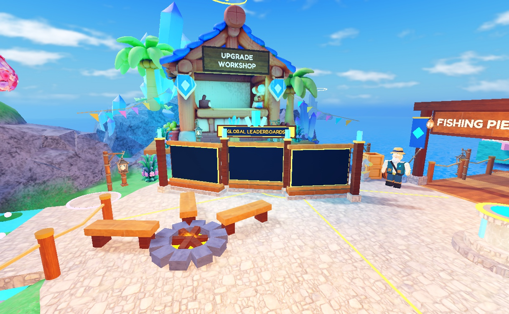
- 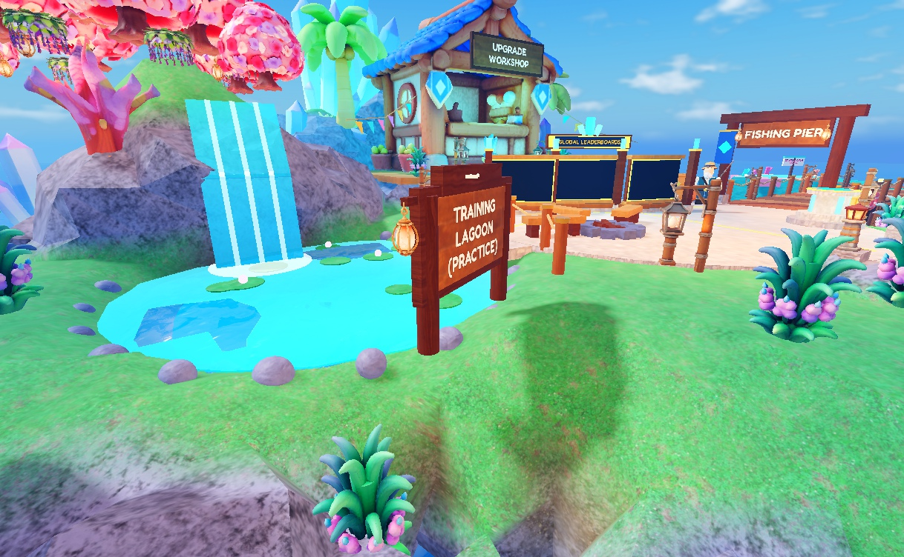
- 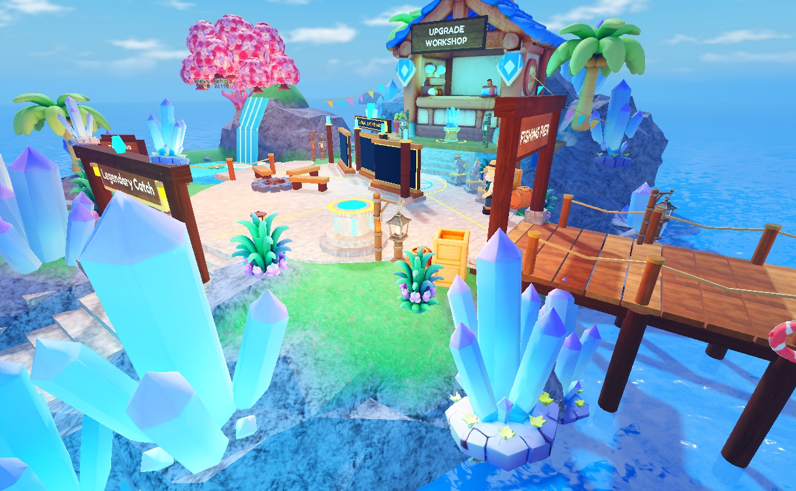
- 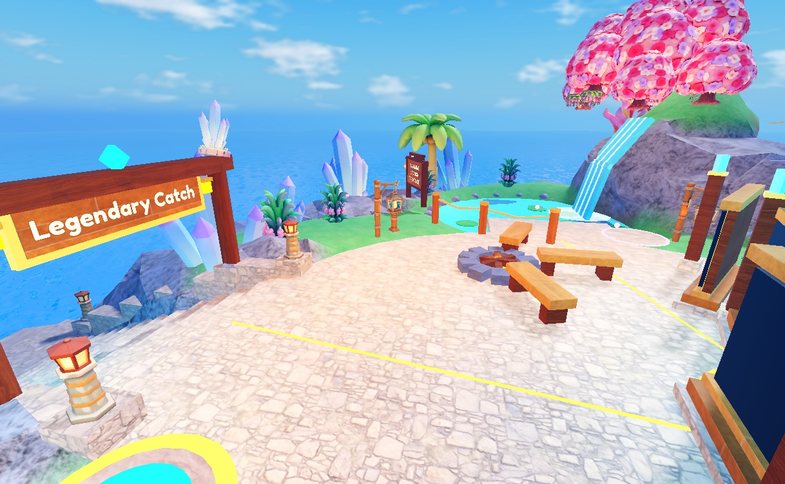

### Depois
- 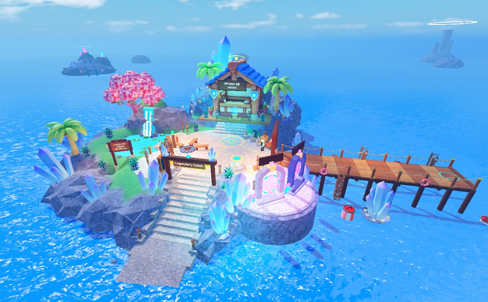
- 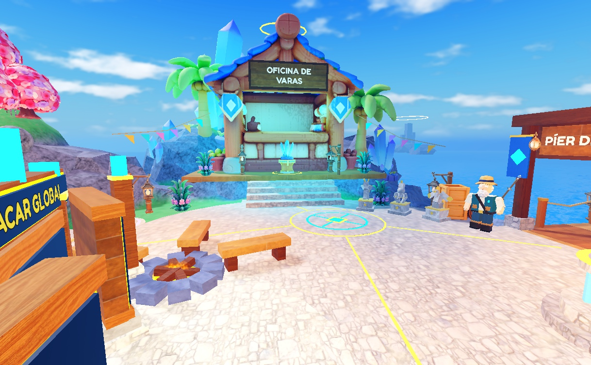
- 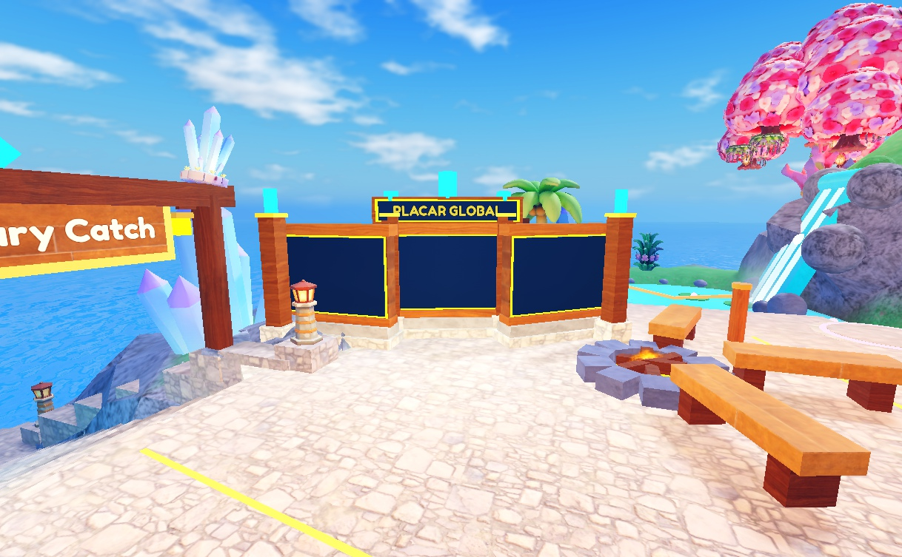
- 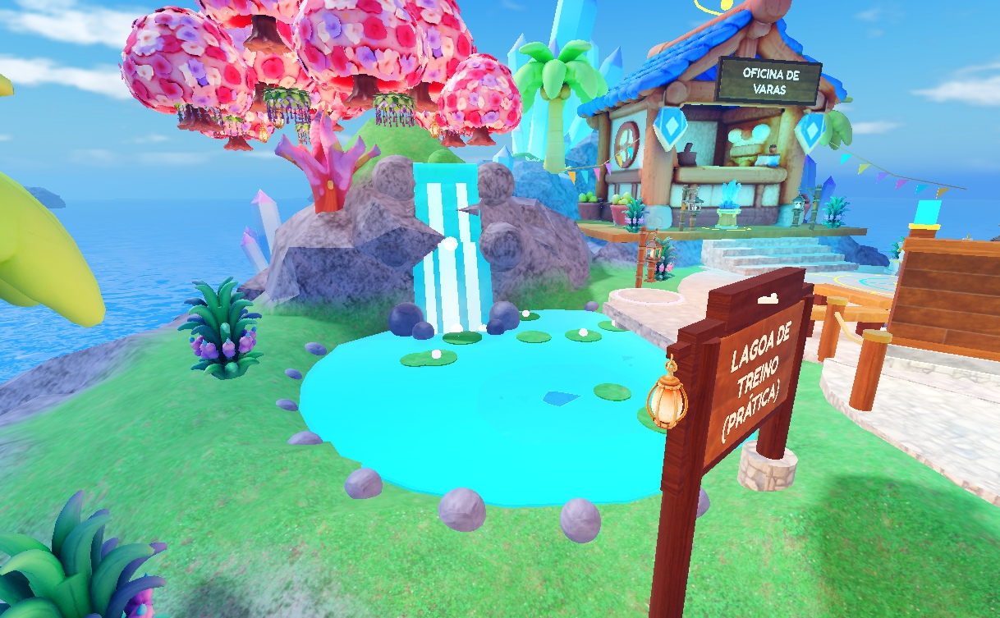
- 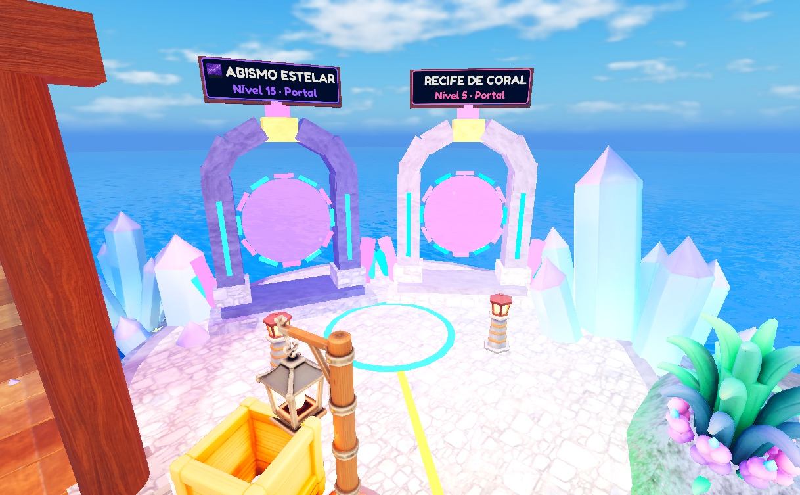
- 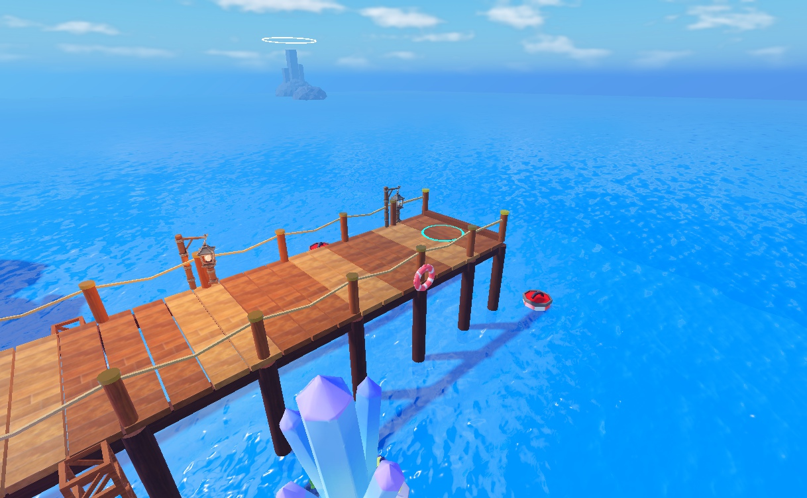
- 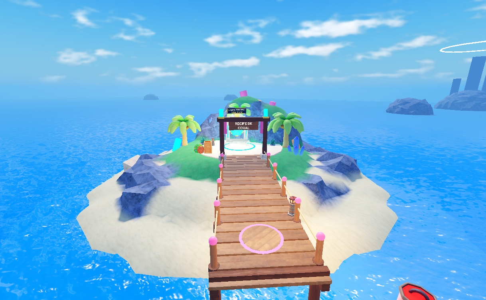
- 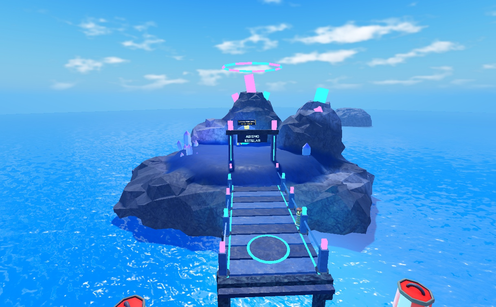
